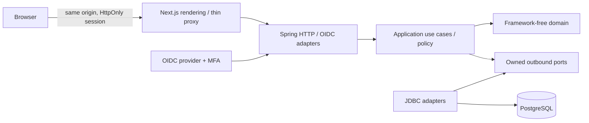
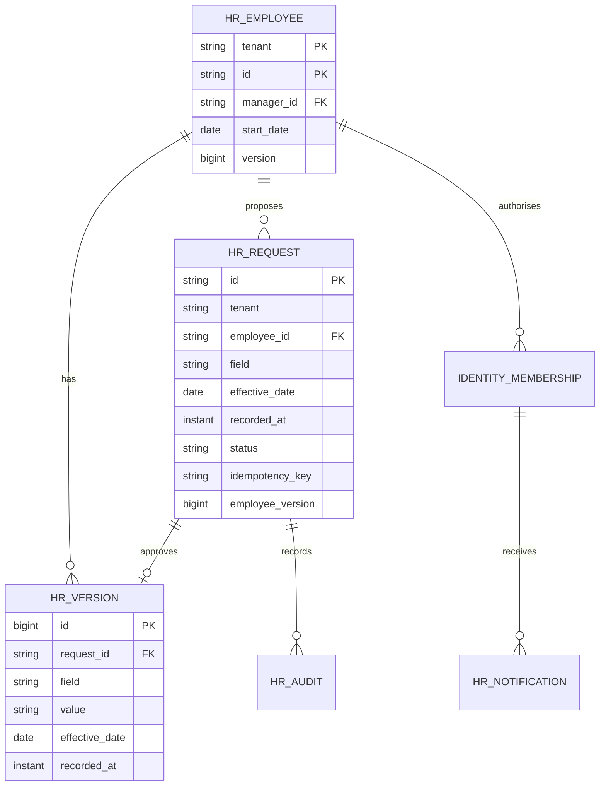

# Architecture and decisions — 2026-10-14

Status: Phase 0 baseline; Phase 1 implementation in progress. Independent product, named Atlas. No SAP or Workday integration assumed.

## ADR-001: Java modular monolith
Java 21 + Spring Boot 4.0.8, Spring Security, JDBC and Flyway; PostgreSQL 18.6. Java offers mature transactions, OIDC integration, deterministic domain tests and a broad maintenance ecosystem. Go has small deployable binaries and good concurrency, but requires more integration work for enterprise identity and transaction conventions. One JVM is operationally sufficient; no broker, cache or distributed services without measured need.

Next.js 16.4.0 / React 19.3.0 already installed; strict TypeScript; native accessible controls, CSS tokens, feature-oriented client components, typed fetch with AbortController and no-store. Native forms plus server validation. No client business-policy authority. Node 24.19.0. Pin direct packages and retain npm lock. Maven parent manages transitive versions. Container tags are pinned versions; digest pinning and image scans are release gates.

Official compatibility references: https://nextjs.org/docs/app/getting-started/installation (Node >=20.9), https://docs.spring.io/spring-boot/system-requirements.html (Java 21 supported), https://www.postgresql.org/support/versioning/ (18 supported). Local Next.js bundled installation, layouts and server/client guides read before coding. Exact runtime interoperability requires executed tests, not just documentation.

## ADR-002: Boundaries
Business modules: corehr, time, documents, payroll, talent, finance, procurement, inventory, sales, manufacturing, assets, projects. Shared identity contracts remain small. Within each: domain/model, application/usecase and port/in + port/out, adapter/in/web and out/persistence, configuration. Domain contains only JDK types. Application owns ports, policy and transaction intent. Composition wraps commands in database transactions. Controllers only call use-case contracts; JDBC adapters only map/query/persist. No framework annotations in domain or application. ArchUnit checks dependency directions and includes a deliberately invalid fixture proving enforcement. Spring Modulith considered: useful when multiple published module APIs exist; ArchUnit is the initial gate and explicit cross-module contracts are required in later phases.

## ADR-003: Data and time
Employee PK is tenant + unique employee ID. Employee -> EmploymentVersion (business effective local date, recorded UTC instant); Employee -> ChangeRequest -> Decision; request/decision -> immutable AuditEvent and in-app Notification. Manager ID is tenant-local FK. A request carries employee version and unique actor-scoped idempotency key. Decisions lock the request and employee, reject stale versions, prohibit self-approval, and append effective-dated history in the same transaction. Future versions are read as-of server business date, not applied early. UTC clock is injected. Backdated corrections that collide with later history are blocked in Phase 1; explicit correction workflow follows Phase 2. PostgreSQL read committed plus bounded row locks; version checks protect stale forms. Audit old/new data remains private and scoped.

Phase 1 owns its approval, audit and notification records inside corehr. Other modules must use published contracts later, never query these tables. Reporting projections will have explicit owning module, tenant scope and consistency metadata before implementation.

Money in later phases uses BigDecimal, explicit currency and configured rounding; snapshots and versioned demonstration rules only until country rules are approved. Payroll release requires independent approval and unique payment/posting keys. Real balanced finance posting is required in Phase 4; provider sandbox success is not live readiness.

## ADR-004: Deployment and API
Browser -> TLS ingress -> Next.js -> Spring -> private PostgreSQL; private object storage and scanning adapter in Phase 2. Local compose supplies PostgreSQL; local identity adapter is explicitly development-only. Production uses maintained OIDC provider with MFA policy; no header-based tenant selection. Principal subject resolves through server-owned membership. Production must not enable local credentials.

/api/v1; JSON; bounded lists, explicit page/size, allowlisted sort/filter. Errors carry status, safe detail, correlationId. 401 unauthenticated, 403 denied, 404 unavailable scoped resource, 409 conflict, 400 validation. POST requires CSRF token with cookie sessions. Commands carry idempotencyKey; conflicting reuse rejects. No automated mutation retries. Fetch timeout 10 s, abort superseded reads. Sensitive responses no-store. Mutations reload authoritative data. No credentials in browser storage. Database IDs and tenant context never establish authority by themselves.

## Open decisions
Countries and statutory rules; legal entities; tenancy model; workforce size and growth; IdP and MFA claims; payroll/bank/email/access integrations; hosting budget; data residency; retention owners; supported locales. Reversible local assumptions: one synthetic tenant, 12 employees, English, UTC effective-date boundary, USD display only, no statutory calculations, HR/manager/employee roles. Proposed capacity: 10k employees growing to 100k. These decisions block live release, not synthetic Phase 1 development.

## Initial data model

Runtime verification: Next.js 16.4.0 + React 19.3.0, Java 21 + Spring Boot 4.0.8, PostgreSQL 18.6 and Keycloak 26.8.0 worked in the executed synthetic workflows. Native CSS is used; the starter Tailwind loader was removed after stale-style/build issues. Spring Security owns OIDC code exchange, issuer/audience validation and cookies; the browser only receives the scoped membership view. The OIDC sandbox uses the maintained provider's TOTP capability (official release: https://www.keycloak.org/2026/10/keycloak-2680-released). Live provider policy and backchannel revocation remain release gates.

Phase 1 deliberately returns bounded authorised arrays (1000 employees, 500 requests); filters, sorting and page controls are frontend-only over that bounded set. The proposed server pagination/filter convention is not yet implemented and must precede large-workforce deployment. API contracts are explicitly typed and documented in OpenAPI; automatic generation is a future improvement. Core use cases expose dedicated AuditEntry and Notification DTOs rather than JDBC map types.

### Application-owned read policy
`PeopleService` resolves each validated actor into `PeopleReadScope` (tenant, subject, employee ID, tenant-wide read permission, direct-report read permission). Only the application chooses those permissions; JDBC binds them as query constraints. The adapter cannot call Actor role/policy methods: an ArchUnit gate and a deliberately invalid outbound adapter fixture enforce that boundary. Identity construction rejects missing identity scope and unknown roles. This scope is an internal application contract, never accepted from HTTP input.

### Directory query contract
The directory uses `/api/v1/directory` and application `DirectoryQuery`/`DirectoryPage`, with no framework pagination types in core interfaces. `PeopleReadScope` governs items, totals and facets. PostgreSQL applies current effective values before filtering and stable name/ID ordering. HTTP rejects out-of-range sizes and unsupported direction. Search is literal substring matching with bound parameters. Page/count/facets are separate read-committed reads (refresh reconciles concurrent changes); no snapshot guarantee. Existing capped bootstrap/dashboard/organisation lists remain separate follow-up work.

### Workspace counts and profile access
Workspace bootstrap uses database aggregates via `PeopleSummary` for total, active, on-leave and submitted-request counts. Aggregates use the same application-selected tenant/self/direct-report constraints as directory and requests. The direct employee profile use case reads within the actor tenant and enforces domain record policy; it never depends on membership in a downloaded page. Organisation remains an explicitly labelled first-100 preview. Request counts describe visible submitted requests, not necessarily actionable independent-review tasks.

### Approval inbox query
`RequestQuery` and `RequestPage` are framework-independent application models. `/api/v1/request-inbox` validates status and bounded page/size parameters; JDBC applies the application-provided `PeopleReadScope` to both count and page. Stable ordering uses recorded UTC time descending and ID ascending. Count and rows are read-committed queries, not a snapshot. The UI no longer consumes the legacy 500-row request endpoint.

### ADR: JDBC-backed web sessions
Use Spring Boot 4.0.8-managed `spring-boot-starter-session-jdbc` / Spring Session 4.0.5, verified from resolved artifacts. The framework integration stays in the outer infrastructure layer; domain/application imports remain framework-free. PostgreSQL owns session and attribute tables through additive Flyway migration V4, copied from the resolved vendor PostgreSQL schema; auto-initialization is disabled. Cookie name remains JSESSIONID; idle timeout is 30 minutes. Official references: https://docs.spring.io/spring-boot/reference/web/spring-session.html and https://docs.spring.io/spring-session/reference/configuration/jdbc.html.

Session state is shared across API instances. A two-process test verifies reuse, restart continuity, peer logout/copied-cookie denial and persisted expiry. Default attribute serialization is framework-managed JDK serialization; session-table writes must be limited to trusted application/database operators and storage encrypted by the selected production platform. Attribute compatibility across application/library upgrades requires staged upgrade testing; do not assume arbitrary cross-version session portability. OIDC code flow/MFA/provider logout was separately exercised with JDBC sessions. Backchannel provider revocation and an administrator's revoke-all workflow remain open.

### Executed response contracts
`tests/support/contract.ts` loads response schemas from `docs/openapi.json` using Ajv's JSON Schema 2020-12 implementation and ajv-formats. `tests/contracts.spec.ts` validates actual authenticated API responses and deliberately malformed fixtures. The frontend's TypeScript contracts are still maintained manually; schema-to-type generation and exhaustive request validation remain follow-up work.

### Department reference ownership
Corehr owns Department and its creation audit. OrganisationUseCases is an application contract used by web adapters and PeopleService; the employee-change controller never reads reference tables. Configuration composes separate JDBC stores and bounded transaction wrappers. Department names/codes/parent/cost-centre mappings are immutable for this increment; future changes require explicit effective versions and costing compatibility. Tenant parent FK, unique code/name, audited creation and actor-key idempotency constrain integrity. Legacy names are preserved and DEMO costing codes are labelled. Finance integration will use published contracts instead of querying HR tables.

### Hiring workflow and transaction ownership
HiringUseCases/HiringService is a separate application workflow within corehr. HireDetails owns input invariants; HireRequest owns submitted/decided transitions and independent-employee review; Employee.forHire constructs initial Onboarding state. Application checks reference/access/duplicate policy and supplies the domain snapshot to the JDBC adapter. A bounded transaction locks the hire request and coordinates employee, audit, notification and durable employee-created handoff writes. Each approved hire is associated with one employee and one unique event. Separate requests racing on one normalized work email are protected by the database unique index. No identity account or payroll record is created by this increment. Downstream consumers require published contracts, idempotent delivery/retry/reconciliation and country/entity configuration before completion.
