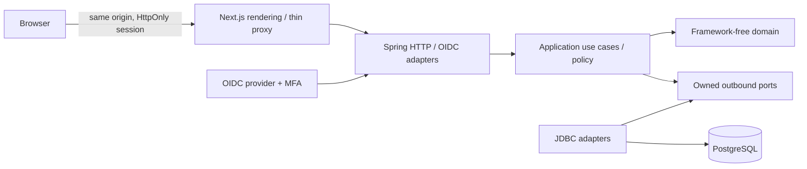
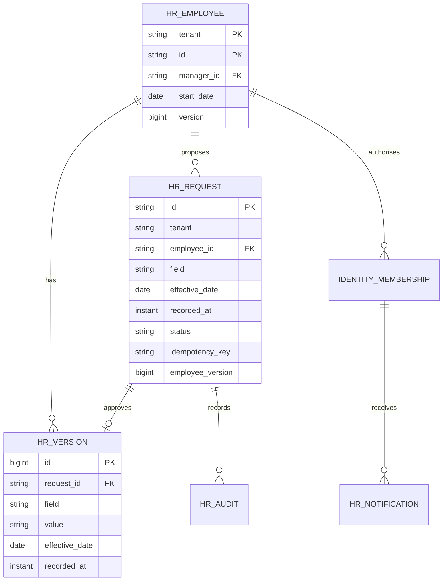
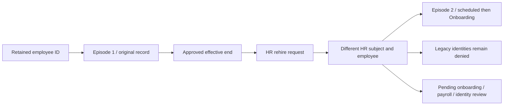
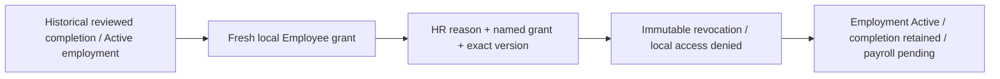
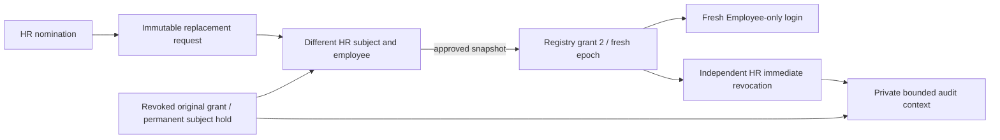
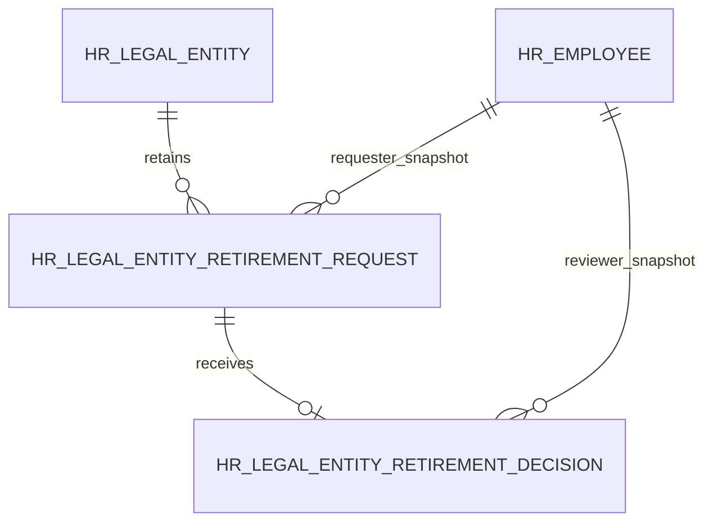
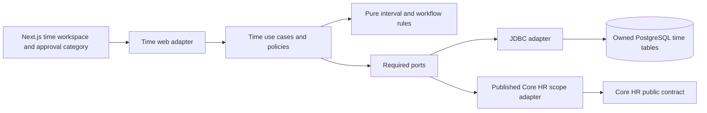

# Architecture and decisions — 2026-10-14

## BK — exact Core HR revision transport

EmployeeChangeInput, PostalAddressInput and OnboardingInput retain HTTP revisions as BigDecimal; their module-local inbound adapter conversion requires exact nonnegative signed-64-bit values before calling unchanged application contracts. No Jackson type crosses the application/domain boundary, no global coercion policy changes, and no business access/concurrency policy moves into adapters. Integral decimal/exponent representations remain compatible. The original 0.5→0 coercion was reproduced through actual HTTP/PostgreSQL before the fix. Jackson documents truncation when float-to-integer coercion is enabled ([official source](https://github.com/FasterXML/jackson-databind/blob/3.x/src/main/java/tools/jackson/databind/DeserializationFeature.java)); explicit inputs avoid dependence on that default.


BG benefit approval queue: `SelectionInboxUseCases`/`SelectionInboxService` resolve current workforce context through the published Core HR adapter and derive explicit `SelectionInboxScope` ownership/exclusion criteria. REVIEW requires HR and excludes target employee/requester subject before count and IDs. `SelectionInboxStore` is a narrow outbound port; the existing owned JDBC adapter implements it and reuses its private snapshot/dependant/audit mapping. One outer read-only repeatable-read transaction bounded10s covers all reads. The existing decision use case now resolves actor/role inside its write transaction and uses domain independence policy; states, replay, audit and handoff rules stay unchanged. No migration/dependency. Offset pages are not a multi-request snapshot. [Scope](benefit-selection-inbox.md).

BF bounded benefit catalogue: `EligibilityWindow.forEmployment` owns the demonstration status/service/date policy; plan explanations use that same window. The application supplies these explicit domain criteria with validated `PlanQuery` to `PlanStore`. JDBC translates thresholds into parameterised filters before count/page selection, without deriving statuses or service days. `PlanBatch` contains bounded domain plans plus a total, never ORM/framework objects. Context/count/rows share an outer read-only repeatable-read transaction bounded10s; plan selection/explanations use one injected UTC date. Published workforce access resolves current context, not historical as-of access. No full-catalogue materialisation or total1000 refusal remains. C-collation name order/code tie-break and PostgreSQL lower-search semantics are explicit; offset pages may shift across creates. No migration/dependency. [Scope](benefit-catalogue-pagination.md).

BE benefit creation journal: additive GET `/api/v1/benefits/creation-history` is owned by the benefits module. `PlanHistoryUseCases`/`PlanHistoryService` authorise through `WorkforcePort` and the published Core HR contract; `PlanHistoryStore` owns required reads, JDBC maps explicit string-ID models and outer configuration supplies a read-only repeatable-read transaction bounded10s. Domain/application import no Spring/JDBC/HTTP types. Watermark/count/rows share one snapshot; later requests retain an untrusted maximum-ID boundary, with lower-ID late-commit limits documented. No cross-module table read or new migration/dependency. Legacy `/benefits/history` remains latest100-compatible/deprecated. [Scope and acceptance](benefit-history-pagination.md).

BD presentation resilience: benefit catalogue and the lazy HR history panel have independent request lifecycles. Only confirmed creation increments the history revision; catalogue retry/filter/page changes preserve open history. Closing the disclosure unmounts its payload and cancels reads. Current identity/tenant/role is part of the remount key; the existing backend remains authoritative for access, eligibility and audit. No new module contract, API, migration, transaction policy or dependency. Latest100 history remains a declared retrieval gap; [scope](benefit-history-resilience.md).

Status: Phase 0 decisions retained; Phase 1 and Phase 2 incremental delivery with executed evidence in verification.md. Source/phase gaps remain tracked; production NOT READY. Independent product, named Atlas. No SAP or Workday integration assumed.

## ADR-001: Java modular monolith

Java 21 + Spring Boot 4.0.8, Spring Security, JDBC and Flyway; PostgreSQL 18.6. Java offers mature transactions, OIDC integration, deterministic domain tests and a broad maintenance ecosystem. Go has small deployable binaries and good concurrency, but requires more integration work for enterprise identity and transaction conventions. One JVM is operationally sufficient; no broker, cache or distributed services without measured need.

Next.js 16.4.0 / React 19.3.0 already installed; strict TypeScript; native accessible controls, CSS tokens, feature-oriented client components, typed fetch with AbortController and no-store. Native forms plus server validation. No client business-policy authority. Node 24.19.0. Pin direct packages and retain npm lock. Maven parent manages transitive versions. Container tags are pinned versions; digest pinning and image scans are release gates.

Official compatibility references: https://nextjs.org/docs/app/getting-started/installation (Node >=20.9), https://docs.spring.io/spring-boot/system-requirements.html (Java 21 supported), https://www.postgresql.org/support/versioning/ (18 supported). Local Next.js bundled installation, layouts and server/client guides read before coding. Exact runtime interoperability requires executed tests, not just documentation.

## ADR-002: Boundaries

Business modules: corehr, time, documents, payroll, talent, finance, procurement, inventory, sales, manufacturing, assets, projects. Shared identity contracts remain small. Within each: domain/model, application/usecase and port/in + port/out, adapter/in/web and out/persistence, configuration. Domain contains only JDK types. Application owns ports, policy and transaction intent. Composition wraps commands in database transactions. Controllers only call use-case contracts; JDBC adapters only map/query/persist. No framework annotations in domain or application. ArchUnit checks dependency directions and includes a deliberately invalid fixture proving enforcement. Spring Modulith considered: useful when multiple published module APIs exist; ArchUnit is the initial gate and explicit cross-module contracts are required in later phases.



## ADR-003: Data and time

Employee PK is tenant + unique employee ID. Employee -> EmploymentVersion (business effective local date, recorded UTC instant); Employee -> ChangeRequest -> Decision; request/decision -> immutable AuditEvent and in-app Notification. Manager ID is tenant-local FK. A request carries employee version and unique actor-scoped idempotency key. Decisions lock the request and employee, reject stale versions, prohibit self-approval, and append effective-dated history in the same transaction. Future versions are read as-of server business date, not applied early. UTC clock is injected. Backdated corrections that collide with later history are blocked in Phase 1; explicit correction workflow follows Phase 2. PostgreSQL read committed plus bounded row locks; version checks protect stale forms. Audit old/new data remains private and scoped.

Phase 1 owns its approval, audit and notification records inside corehr. Other modules must use published contracts later, never query these tables. Reporting projections will have explicit owning module, tenant scope and consistency metadata before implementation.

Money in later phases uses BigDecimal, explicit currency and configured rounding; snapshots and versioned demonstration rules only until country rules are approved. Payroll release requires independent approval and unique payment/posting keys. Real balanced finance posting is required in Phase 4; provider sandbox success is not live readiness.

## ADR-004: Deployment and API

Browser -> TLS ingress -> Next.js -> Spring -> private PostgreSQL; private object storage and scanning adapter in Phase 2. Local compose supplies PostgreSQL; local identity adapter is explicitly development-only. Production uses maintained OIDC provider with MFA policy; no header-based tenant selection. Principal subject resolves through server-owned membership. Production must not enable local credentials.

/api/v1; JSON; bounded lists, explicit page/size, allowlisted sort/filter. Errors carry status, safe detail, correlationId. 401 unauthenticated, 403 denied, 404 unavailable scoped resource, 409 conflict, 400 validation. POST requires CSRF token with cookie sessions. Commands carry idempotencyKey; conflicting reuse rejects. No automated mutation retries. Fetch timeout 10 s, abort superseded reads. Sensitive responses no-store. Mutations reload authoritative data. No credentials in browser storage. Database IDs and tenant context never establish authority by themselves.

## Open decisions

Countries and statutory rules; legal entities; tenancy model; workforce size and growth; IdP and MFA claims; payroll/bank/email/access integrations; hosting budget; data residency; retention owners; supported locales. Reversible local assumptions: one synthetic tenant, 12 employees, English, UTC effective-date boundary, USD display only, no statutory calculations, HR/manager/employee roles. Proposed capacity: 10k employees growing to 100k. These decisions block live release, not synthetic Phase 1 development.

## Initial data model



Runtime verification: Next.js 16.4.0 + React 19.3.0, Java 21 + Spring Boot 4.0.8, PostgreSQL 18.6 and Keycloak 26.8.0 worked in the executed synthetic workflows. Native CSS is used; the starter Tailwind loader was removed after stale-style/build issues. Spring Security owns OIDC code exchange, issuer/audience validation and cookies; the browser only receives the scoped membership view. The OIDC sandbox uses the maintained provider's TOTP capability (official release: https://www.keycloak.org/2026/10/keycloak-2680-released). Live provider policy and backchannel revocation remain release gates.

Phase 1 deliberately returns bounded authorised arrays (1000 employees, 500 requests); filters, sorting and page controls are frontend-only over that bounded set. The proposed server pagination/filter convention is not yet implemented and must precede large-workforce deployment. API contracts are explicitly typed and documented in OpenAPI; automatic generation is a future improvement. Core use cases expose dedicated AuditEntry and Notification DTOs rather than JDBC map types.

### Application-owned read policy

`PeopleService` resolves each validated actor into `PeopleReadScope` (tenant, subject, employee ID, tenant-wide read permission, direct-report read permission). Only the application chooses those permissions; JDBC binds them as query constraints. The adapter cannot call Actor role/policy methods: an ArchUnit gate and a deliberately invalid outbound adapter fixture enforce that boundary. Identity construction rejects missing identity scope and unknown roles. This scope is an internal application contract, never accepted from HTTP input.

### Directory query contract

The directory uses `/api/v1/directory` and application `DirectoryQuery`/`DirectoryPage`, with no framework pagination types in core interfaces. `PeopleReadScope` governs items, totals and facets. PostgreSQL applies current effective values before filtering and stable name/ID ordering. HTTP rejects out-of-range sizes and unsupported direction. Search is literal substring matching with bound parameters. Page/count/facets are separate read-committed reads (refresh reconciles concurrent changes); no snapshot guarantee. Existing capped bootstrap/dashboard/organisation lists remain separate follow-up work.

### Workspace counts and profile access

Workspace bootstrap uses database aggregates via `PeopleSummary` for total, active, on-leave and submitted-request counts. Aggregates use the same application-selected tenant/self/direct-report constraints as directory and requests. The direct employee profile use case reads within the actor tenant and enforces domain record policy; it never depends on membership in a downloaded page. Organisation remains an explicitly labelled first-100 preview. Request counts describe visible submitted requests, not necessarily actionable independent-review tasks.

### Approval inbox query

`RequestQuery` and `RequestPage` are framework-independent application models. `/api/v1/request-inbox` validates status and bounded page/size parameters; JDBC applies the application-provided `PeopleReadScope` to both count and page. Stable ordering uses recorded UTC time descending and ID ascending. Count and rows are read-committed queries, not a snapshot. The UI no longer consumes the legacy 500-row request endpoint.

### ADR: JDBC-backed web sessions

Use Spring Boot 4.0.8-managed `spring-boot-starter-session-jdbc` / Spring Session 4.0.5, verified from resolved artifacts. The framework integration stays in the outer infrastructure layer; domain/application imports remain framework-free. PostgreSQL owns session and attribute tables through additive Flyway migration V4, copied from the resolved vendor PostgreSQL schema; auto-initialization is disabled. Cookie name remains JSESSIONID; idle timeout is 30 minutes. Official references: https://docs.spring.io/spring-boot/reference/web/spring-session.html and https://docs.spring.io/spring-session/reference/configuration/jdbc.html.

Session state is shared across API instances. A two-process test verifies reuse, restart continuity, peer logout/copied-cookie denial and persisted expiry. Default attribute serialization is framework-managed JDK serialization; session-table writes must be limited to trusted application/database operators and storage encrypted by the selected production platform. Attribute compatibility across application/library upgrades requires staged upgrade testing; do not assume arbitrary cross-version session portability. OIDC code flow/MFA/provider logout was separately exercised with JDBC sessions. Backchannel provider revocation and an administrator's revoke-all workflow remain open.

### Executed response contracts

`tests/support/contract.ts` loads response schemas from `docs/openapi.json` using Ajv's JSON Schema 2020-12 implementation and ajv-formats. `tests/contracts.spec.ts` validates actual authenticated API responses and deliberately malformed fixtures. The frontend's TypeScript contracts are still maintained manually; schema-to-type generation and exhaustive request validation remain follow-up work.

### Department reference ownership

Corehr owns Department and its creation audit. OrganisationUseCases is an application contract used by web adapters and PeopleService; the employee-change controller never reads reference tables. Configuration composes separate JDBC stores and bounded transaction wrappers. Department names/codes/parent/cost-centre mappings are immutable for this increment; future changes require explicit effective versions and costing compatibility. Tenant parent FK, unique code/name, audited creation and actor-key idempotency constrain integrity. Legacy names are preserved and DEMO costing codes are labelled. Finance integration will use published contracts instead of querying HR tables.

### Hiring workflow and transaction ownership

HiringUseCases/HiringService is a separate application workflow within corehr. HireDetails owns input invariants; HireRequest owns submitted/decided transitions and independent-employee review; Employee.forHire constructs initial Onboarding state. Application checks reference/access/duplicate policy and supplies the domain snapshot to the JDBC adapter. A bounded transaction locks the hire request and coordinates employee, audit, notification and durable employee-created handoff writes. Each approved hire is associated with one employee and one unique event. Separate requests racing on one normalized work email are protected by the database unique index. No identity account or payroll record is created by this increment. Downstream consumers require published contracts, idempotent delivery/retry/reconciliation and country/entity configuration before completion.

### Manual onboarding transition

Employee owns the Onboarding → Active invariant and start-date guard without framework dependencies. HiringService enforces HR policy, replay consistency and optimistic version intent in the existing bounded transaction. JDBC implements the status update plus immutable completion and pending event; it does not choose transitions. Completion business-effective date is the actual UTC confirmation date, distinct from original employment start and UTC recording instant. Team history redacts reasons in application policy. V10/V11 enforce unique initial completion and composite tenant/hire/employee integrity. This is manual confirmation; background activation and downstream consumers remain planned.

Optional private-field removal reuses ChangeRequest and effective versions. The domain permits explicit empty strings only for address/emergency fields; null/whitespace and required field blanks fail validation. Existing application no-change, access, optimistic version, independent review and transaction boundaries apply. Empty version values supersede earlier values without removing audit history; no migration or new dependency is needed.

### Position reference ownership

Corehr owns Position and creation audit through OrganisationUseCases. The domain validates code/title/department/date shape; application enforces HR creation, tenant department existence/start consistency and idempotent snapshots. JDBC owns parameterised search/count/page and atomic reference/audit writes. V12 enforces tenant/code, actor/key and same-tenant department constraints; immutable triggers prohibit editing/deleting references/audit. PositionPage is framework-independent; title ordering is validated at the core boundary and code breaks ties. Count and page are read-committed statements, not one snapshot. This is a reference catalogue; no employee assignment or inferred reporting line is implemented.

### Effective-dated primary position assignment

Employee exposes one positionCode (empty means Unassigned). It is an employment attribute independent of title, pay and manager. PeopleUseCases reuses the change approval workflow; OrganisationUseCases publishes position/dept validity within corehr. With employee row locked, application validates proposed department/position pairs at the command date and every approved future department/position boundary. The domain owns department/date alignment and employment-start guards. Existing later-same-field and employee-version guards prevent replacing a scheduled future version. Approval atomically writes effective version, immutable FK-backed assignment ledger, decision audit and notification. V14 requires each assignment ledger row to match an approved request and effective version. Read models derive as-of position from hr_version; recovery reconciles both representations.

Effective field reads order by business date, recording instant, then version ID. The ID breaks ties when two sequential approvals share an instant; a fixed-clock PostgreSQL test proves assignment followed by unassignment remains correctly ordered.

### Effective reporting and access

PeopleUseCases owns reporting commands/candidate reads. ReportingHierarchy is framework-free and validates employee/manager start dates plus self/ancestor cycles at each affected approved future manager boundary. Provisional management eligibility is application-owned HR/MANAGER membership; JDBC accepts the policy role set. A tenant-scoped PostgreSQL transaction advisory lock serializes reporting mutations and hire approvals before row locks. Hash collisions can conservatively serialize unrelated tenants; they cannot mix data. Transaction timeout remains 10 seconds. Validation fails visibly above 10,000 employees or 256 future boundaries instead of using a truncated graph.

Effective manager projection is applied consistently to profile, directory, legacy lists, summaries and inbox scopes at the injected UTC business date. Manager changes do not grant a role. Requester visibility for their own non-private submissions remains intentional; team record/history access is removed when the line changes. V15 assignment ledger mirrors approved manager versions with employee/manager/request foreign keys and consistency/immutability triggers. Reporting changes and position changes remain separate commands.

### Employee display-name projection

Name is now a supported effective employee field. Employee/HR may initiate; independent HR decides. Domain validates bounded Unicode strings and rejects control characters/blank values. Directory/profile/legacy employee reads, request display names, manager candidates and Actor workspace labels use the same as-of name rule with effective date/recording instant/version-ID ordering. Membership continues to own subject/tenant/role/employee ID; the workspace name is an employee projection, not an identity-provider profile update. Audit and commands retain stable identifiers and old/new name values.

### Pending-change withdrawal and command replay

Requester-owned withdrawal is a distinct application use case and domain transition, not rejection by an approver. Request row lock arbitrates review versus withdrawal; terminal requests cannot be reopened or withdrawn. V17 records immutable reason/key/actor/correlation and requires a matching requester-owned Withdrawn state. Audit and in-app notice commit in the same transaction; no employment version is created. Private-field owner visibility is checked under current permissions. Non-private owners retain their own request context when team scope changes, consistent with inbox policy.

Submit now requires a nullable boxed version at the transport-independent command boundary; missing/null is invalid, rather than default zero. Input shape is validated before replay; new-command date-range validation occurs after matching replay lookup. Identical past-effective replay can recover an existing request; new backdated commands remain invalid. Input, identity and field permission checks still apply to replay.

### ADR: benefits capability and governed shared errors

Benefits owns BenefitPlan and configuration audit, with framework-free domain/application and explicit web/JDBC/workforce adapters. Core HR publishes WorkforceAccess.self(subject): authenticated subject, server tenant/employee/role and own employment status/start only. Benefits integration adapter maps that contract into its own application context; it never accesses Core HR internal classes or tables. ArchUnit enforces both capability directions and a forbidden-import fixture.

The shared domain package contains only AccessDenied, CommandConflict and InputValidation error primitives. Existing Core HR error types retain compatible subclasses; the outer HTTP error adapter translates shared errors. Identity, money, rules and repositories are not centralised in shared code. Each capability owns its UnitOfWork port and framework transaction composition. Benefits tables/triggers are independently owned; no cross-module foreign keys.

Benefit eligibility is explicitly DEMONSTRATION, based on current self employment snapshot plus plan start/service days. Fixed monthly contribution is configured decimal data, normalized exactly to two places with UNNECESSARY rounding; API transmits decimal strings. One evaluation date governs a catalogue response. Immutable plan rule version is stored (V19), not inferred from deployment alone. Plan listing applies domain eligibility before filter/sort/page, with visible 1000-reference protection. No actual enrolment, dependant calculation or payroll output exists yet.

### ADR: benefits selection snapshots and payroll handoff

Benefits owns selections, dependant snapshots, append-only decision audit and pending deduction handoffs (V20/V21). Core HR publishes an additional minimal `WorkforceAccess.employee` contract: only self or HR, server membership and tenant enforced by Core HR; benefits imports no internal HR classes/tables. Employee ID captured at submission prevents alias self-approval even after a requester identity mapping changes. Current HR employment snapshot is rechecked against the original business date before approval.

The DEMO-FIXED-MONTHLY-v1 policy fixes monthly employee contribution independent of dependant count. No surcharge/proration, statutory eligibility or provider contract is inferred. Up to five named dependants, relationship only; no government IDs or dates of birth. Submission UTC local date is the benefit effective date; future/backdated selection is not exposed. Approved snapshot creates one `PENDING_PAYROLL` row atomically with audit. No payroll consumer, accounting/payment or provider delivery exists; this is an owned pending handoff, not verified payroll integration. Phase 4 must consume via a published contract with idempotency/reconciliation and validate country/entity/company rules.

READ COMMITTED, bounded 10-second transactions: tenant/employee advisory lock serialises submissions; partial unique index prevents multiple pending/approved employee-plan selections; request row locks arbitrate decisions. Deferred database checks reconcile final state, plan snapshot, audit and handoff at commit. Plan/dependant/audit/handoff records cannot be updated/deleted by normal workflow; selection changes only PENDING→APPROVED/REJECTED with version 0→1. Paginated selection reads use bounded adapter queries, including per-request history/dependants; load targets remain unmeasured. Cancellation/amendment and downstream correction semantics remain planned.

### ADR: private employee text documents, local storage and scanning ports

Documents is a separate capability with framework-free `DocumentPolicy`, application use cases and owned persistence/storage/scanner/identity ports. It consumes only Core HR's published self-employment contract; an architecture rule and forbidden-import fixture enforce that boundary. V22 owns metadata/audit and its own immutable-record functions; no other module's tables or trigger functions are used.

Initial workflow supports own UTF-8 .txt uploads of 1–16384 bytes, with a provisional 100-document employee cap; HR reads tenant records, employee/manager reads self only. Filename/type/content validation, availability from CLEAN/INFECTED/UNAVAILABLE verdicts, access policy, hashing and replay checks stay in the core. The ClamAV adapter translates the documented [INSTREAM protocol](https://docs.clamav.net/manual/Usage/ClamdProtocol.html) and does not decide business availability. The pinned local image is configured according to [official Docker guidance](https://docs.clamav.net/manual/Installing/Docker.html); bundled signatures are intentionally a demonstration limitation, not production malware assurance.

Private object keys are SHA-256(tenant)/SHA-256(content), generated server-side; keys and hashes are not public DTO fields. The local adapter is outside web/static directories, enforces canonical paths/no symlinks and POSIX 0700 directories/0600 files. It is enabled only for local/oidc-demo profiles; production needs a private object-store adapter, encryption/access policy and validated scanner freshness. No public object URL or client tenant selector exists. Download authorisation precedes object access, requires AVAILABLE and matching byte count/hash, returns an attachment with no-store/nosniff/sandbox headers, and records authorisation rather than claiming network receipt.

Storage and scan occur outside the 10-second database transaction. Metadata plus immutable upload/scan audits commit together; tenant/employee advisory lock and database uniqueness serialise duplicate commands/quota checks. A crash or database failure can leave an unreferenced private object; no automatic destructive cleanup is exposed while retention policy is unresolved. Partial/corrupt objects fail integrity checks and require operator repair. This is not an atomic database/object-store transaction. Scan outage produces QUARANTINED with blocked retrieval; retries/versioning are next Phase 2 work. Restore verifies database metadata and independently copies/hash-checks referenced objects into a separate private root; production encrypted backup/PITR remains unverified.

### ADR: append-only document scan retries

V23 adds a documents-owned immutable retry ledger. Original upload/initial scan metadata remain unchanged; catalogue/download projections coalesce the latest committed retry status/scanner/attempt. Original audit plus retry records form the authorised history. Retry events retain actor, reason, UTC instant, correlation and scanned content hash; no second write to the initial upload audit is needed. The projection is immediately consistent after the command commit, under READ COMMITTED; list pages are not a global snapshot across concurrent uploads.

Only HR may rescan QUARANTINED content; three retries maximum, with AVAILABLE/REJECTED terminal. Required expected attempt is parsed exactly (fractional values rejected). Scanner work occurs outside database transactions and is repeatable; the final transaction locks the original document, rechecks authoritative identity/version/state/key and appends one result. Concurrent calls may perform duplicate safe external scans, but only one ledger result commits for a version. Identical key replay returns the recorded attempt snapshot even if a later attempt changed current status; upload replay returns the current document projection. Catalogue refresh shows latest availability. A request interrupted before commit can repeat safely; after commit it replays without another scan. There is no background job, automatic retry, durable RUNNING lease, exactly-once external delivery or manual malware bypass.

Database triggers enforce original quarantine, matching hash, sequential attempt ≤3 and previous quarantine; immutable rows/unique keys enforce retention of every result. Download audit validation uses effective availability while original scan audit stays intact. Production scanner freshness and object-storage/retention policies remain separate release gates.

### ADR: immutable employee document versions

V24 adds a Documents-owned append-only root/parent/version ledger. Each replacement creates new immutable metadata, bytes and independent scan/audit records. `DocumentVersionPolicy` enforces append-to-latest and bounded ordinals; the application enforces identity, record access, exact expected version, stable command replay and employee quota. Database foreign keys, unique parent/root ordinal and owner/snapshot/sequential triggers protect integrity. Initial files project as version 1 without rewriting earlier migrations or data.

Storage/scanning precede a bounded transaction. Final identity revalidation, employee advisory lock and root row lock protect quota and concurrent append; one competing command wins. Metadata, scan audits and version link commit atomically. A replay returns the recorded version, even after later appends. UI/search/count show latest uploaded version, including blocked latest; explicit historical downloads still require authorisation and that version's current clean scan/hash/size checks. There is no implicit fallback or legal-validity claim. Limit: 100 total stored files per employee and 100 versions per chain. Templates, retention/legal holds/completeness and production storage remain open.

### ADR: configured templates and document completeness

Documents owns `DocumentTemplatesUseCases`, framework-free configuration/completeness policy and ports. JDBC/web adapters and composition remain outside the core. V25 owns immutable tenant template configuration and document evidence ledgers; existing document metadata/bytes are unchanged. Templates are reusable plain text with explicit required flag and local effective date. Configuration applies to every employee record in the tenant; it is not a statutory policy. Limits: 100 templates, text 4000 characters, existing 100 stored-file limit per employee. Template amendments, targeting, unlink/reclassification and content approval remain planned.

An authenticated self/HR record check uses only Core HR's published workforce contract. Linking requires a current clean version and exact ordinal; root row and employee advisory locks serialize with version changes and competing classifications. Unique tenant/code/employee and tenant/root keys prevent duplicate classifications. Stable command replay returns the recorded link even after later versions. Immutable creation/link snapshots retain actor, reason, UTC recording instant and correlation ID. A database trigger checks the owner/root, latest ordinal and clean availability at insertion. Clean means scan availability, not content validity.

Completeness uses injected UTC date and latest version/scan projection: NOT_YET_EFFECTIVE, OPTIONAL, MISSING, PRESENT or BLOCKED. A rejected/quarantined replacement blocks required completeness without historical fallback. Read checks are bounded live projections, not a transactionally frozen compliance report. The UI permits own checks and HR lookup of a server-authorised employee identifier; identity/tenant are never selected by client request. No new service, cache or message broker is needed.

### ADR: append-only template maintenance and HR corrections

V26 adds Documents-owned template revision and classification-correction ledgers, leaving V25 creation/link rows unchanged. DocumentMaintenanceUseCases separates privileged maintenance orchestration; DocumentTemplatePolicy owns version/date/terminal-retirement transitions. Configuration projections select latest ordinal effective on injected UTC date; future snapshots and all prior text/reason/actor/timestamps remain in revision history. Same-day changes use ordinal order. Dates must be today/future and nondecreasing; a retirement snapshot is terminal, including scheduled retirement. No implicit withdrawal/reactivation or independent approval exists yet.

HR corrections append a new current classification for an existing employee/template, requiring exact current classification and clean latest file ordinals. Current completeness switches to the replacement root; old roots stay reserved and readable under original document permissions. No evidence, private content or initial audit is deleted. Unique correction ordinals, previous-root consistency, owner/latest/clean checks and immutable triggers provide SQL integrity. Initial and correction writers serialize through tenant template lock → employee lock → candidate root lock; original link rows also serialize direct SQL correction sequence checks. Reservation guards prevent a historical root from being reused as initial evidence. Maximum 100 revisions/classification snapshots; global event view returns latest 100, per-template history retains its bounded complete trail. Live projections remain non-frozen reports, not legal compliance or content approval.

### ADR: chain retention directives and independent legal holds

Documents owns DocumentRetentionUseCases/Service, framework-free DocumentRetentionPolicy, persistence port and web/JDBC adapters. V27 appends one per-root governance journal; V28 adds original-subject release protection without changing an applied migration. HR explicitly supplies retain-until date and company policy basis, not a statutory default. Policy dates start today/future and may only extend; date-only comparisons use injected UTC business date, inclusive through retain-until. States: NO_POLICY, RETAIN, REVIEW_DUE, ON_HOLD. Due means review, never permission to delete. Country/category/entity policy validation and production records governance remain unresolved.

Multiple case holds are independent. Active case references are unique within the chain; release requires a different actor subject and employee identity, protecting aliases and identity rebinding. Hold placement/release and policy writes share exact root governance ordinal, bound idempotency key and immutable actor/employee/reason/UTC recording/correlation snapshot. A command locks employee then root in a 10-second transaction; sequence/shape/owner/root/non-shortening/hold transition/independence/append-only SQL guards provide second-line integrity. At most 100 journal events; overflow fails closed with no bypass.

Any file version resolves to its immutable root, so governance includes historical and future versions without copying legal data into employee-visible document audit. Review and mutations are HR-only; the existing workforce contract supplies server identity and tenant. No private-object delete, archive, purge or financial-history deletion port is introduced. Future archive/deletion processing must consult governance through a published contract and reconcile all live/archived/deduplicated references and backups before any destructive action. `deletionAvailable` is always false in the API contract.

### ADR: minimal scoped organisation branches

OrganisationBrowseUseCases/Service owns a separate chart read workflow within Core HR. It resolves the current actor inside a 10-second read-only REPEATABLE READ transaction; branch, count, visible-manager context and effective projections share one UTC as-of date/snapshot. PeopleReadScope.of centralises the existing HR/manager/employee policy, and Actor.canReadEmployee reuses domain record checks. JDBC translates application scopes; it neither resolves roles nor reads another module's tables. No migration, graph database, cache or distributed service is needed.

The chart port returns scoped internal entries; HTTP exposes only ID/name/title/department/position/status and visible-direct-report count. Effective fields use the same approved-version date/recording/ID order as existing people reads. HR roots cover the tenant hierarchy; manager/employee root is self, with manager access limited to current direct reports. Hidden manager identifiers and hidden descendant counts are not returned. Root/branch/global literal search is sorted by lower-case name then ID, with size 1–50 and bounded page. Parent and non-empty search are mutually exclusive. Invalid or inaccessible parents fail without mutation. Results include current onboarding records; this does not implement future scenario planning.

UI is independent of directory page/filter state, shows one branch at a time, keeps up to 50 recent branch locations, and preserves chart state around a profile panel. Profile opening fetches the real profile API, repeats access checks and aborts on navigation/identity context change. Graph-wide rendering, matrix lines, root removal, bulk hierarchy changes and position-capacity policy remain outside this delivered subset. No workload latency/capacity target is inferred from correctness fixtures.

### ADR: resignation acceptance precedes exit execution

Core HR owns Resignation domain transitions, ResignationUseCases/Service, application command/page/audit models, persistence port and HTTP/JDBC adapters. Composition supplies injected UTC Clock, 10-second READ COMMITTED write transactions and read-only REPEATABLE READ list/history transactions. Identity and tenant resolve inside each use case. Self submission applies to active/on-leave employees of every role; no on-behalf or manager-team case access. Independent HR review requires both a different subject and employee identity. This is provisional company workflow, not a country notice-period calculation. Proposed last working date is today through one year; past-date approval is blocked, rejection remains available.

V29 owns tenant-keyed request, immutable audit and immutable pending exit-handoff tables. Additive V30 strengthens audit-only insert reconciliation without rewriting V29. Employee lock → request lock serialises decisions; an exact employee-version snapshot prevents stale approval and an exact request ordinal protects review. Submission/decision keys bind stable inputs; identical replay returns the original request outcome even after date changes. One outstanding submitted/approved case per employee; rejection allows fresh submission. SQL snapshot/transition/independence/unique/foreign-key guards and deferred audit/handoff reconciliation protect integrity. Approval atomically records decision, audit, one PENDING_EXIT_COORDINATION handoff and a private requester notification. No employee status/version, payroll record or identity account changes. Future delivery attempts must use a separate persistent delivery ledger, not edit this immutable handoff.

UI uses feature-local typed contracts, cancellable scoped reads, no sensitive browser storage, preserved errors/linked focus, a bounded paginated workspace and explicit review impact. Identity/tenant/role changes remount private state. Separate resignation workspace contributes to SH-02 but is not a unified cross-module inbox; delegation/withdrawal/amendment are not implemented. Full termination, final-pay rules, exit tasks and dated access revocation remain separately tracked dependencies.

### ADR: manual exit-task coordination within Core HR

ExitTaskUseCases/Service owns assignment/completion orchestration, ExitTask holds state/scheduling/assignee invariants, application models carry explicit commands and scoped pages, and web/JDBC adapters remain at the boundary. Composition injects UTC Clock, bounded READ COMMITTED writes and read-only REPEATABLE READ lists/history. Core HR ports stay framework-free; no module table access or distributed service is introduced. HR case reading does not grant proxy completion. Assignee access never invokes or widens private resignation permissions.

V31 adds tenant-owned task snapshots and immutable status audit. Independent HR coordinator locks an approved resignation before appending the next ordinal, with exact expected count and a 50-task cap. An existing tenant employee with configured identity is required. Creation binds tenant/subject/key to immutable inputs; completion locks one task and checks current assigned employee, exact version and stable decision key. OPEN → COMPLETED is terminal; only assignee attestations are accepted. SQL protects approved-case/employee ownership, sequential ordinal, creation snapshots, assignment identity on completion and deferred matching audit count/content. Original resignation/exit handoff is never rewritten. Notifications are atomic private in-app records routed to existing assignee identities and the coordinator.

Due date is an explicitly configured company scheduling date (today through one year), not notice policy or employment termination. Audit effective date retains that due-date business context; recordedAt/completedAt are actual UTC instants. Server derives overdue for OPEN tasks from injected UTC date; late completion is allowed and records actual completion time. No task automatically removes access, settles payroll, returns assets or completes employment. A future orchestration/delivery ledger must coordinate real downstream actions and reconcile outcomes separately. No reassignment, cancellation, reopening, proxy completion or task dependencies in this subset.

### ADR: append-only exit-task management and current-assignment projection

Additive V32 preserves original V31 assignments, completion rows and audit. A tenant/task management journal appends REASSIGN or CANCEL with exact input aggregate version, sequential ordinal (1–100), old/new assignee/state, actor/employee, reason, UTC instant, key and correlation. Independent HR coordinates; completed/cancelled tasks are terminal. Reassignment requires a different configured tenant identity. Cancellation retains the current assignee and all history; it never frees the original 50-task case quota. Stable management replay returns the original immutable event receipt even after later completion, without notifications being repeated.

Core HR owns the synchronous `hr_exit_task_current` view. It projects latest assignment/cancellation over the original task, with completion taking precedence and aggregate version = management ordinal + original completion version. Only Core HR adapters query the view; database permissions should remain with that module's application role, never direct user access. There is no cross-module SQL, cache, async projection or eventual-consistency promise. Read-only REPEATABLE READ use cases keep current assignment, scoped totals and histories in one snapshot. Non-HR lists/history/completion use the current employee assignment; management history/reasons are HR-only. Already viewed client data cannot be recalled; every subsequent authorised API read is rechecked.

Management locks approved case → base task. Task locking is a separate statement before a fresh projected read: a projection evaluated before waiting for the row lock could otherwise miss a newly committed management event. Completion locks the same base task; SQL independently checks latest assignment and rejects cancelled-task completion, including calls from older code. Original creation replay validates original input then reads the current projection. Completion replay checks the persisted terminal aggregate version. Domain/application contracts stay framework-free; adapters implement persistence/HTTP only, composition owns transactions. Database guards enforce sequential immutable management, coordinator/identity facts and terminal states. Notifications to old/new assignee identities contain no management reasons.

Rollback constraint: an application version that reads original assignment directly can disclose data to a former assignee after management events. Such versions are unsafe rollback targets even though new SQL guards reject their obsolete completion writes. Keep management-aware reads/permissions in any rollback build, or roll forward; database point-in-time/logical recovery is a separate audited action. No destructive migration reversal is provided.

### ADR: immutable effective employment end with request-time local denial

Core HR owns EmploymentEnd domain dates/state, EmploymentEndUseCases/Service, explicit commands/context, ports and thin web/JDBC adapters. V33 adds immutable end/audit snapshots plus two unique immutable PENDING handoffs (FINAL_PAY and EXTERNAL_IDENTITY), and an effective-status SQL read projection. Approved last working date is inclusive; first inactive date is the next local date, enforced from 00:00 UTC. This is a provisional company convention, not statutory notice/final-pay logic. HR reason/key/current employee version are required; a different employee must confirm. Employee base status/identity/history remain retained; version increments at scheduling to invalidate stale pending commands. Profile/directory/summary/chart project Ended at the boundary without waiting for a worker.

Scheduling requires approved resignation, Active/On-leave status, no OPEN own-case tasks or other exit tasks assigned to the employee, and no active/planned reports at the end or approved future reporting boundaries (maximum 256 dates). The tenant workforce/reporting advisory lock serialises lifecycle, reporting, hire decisions and task assignment/management before employee/case locks; SQL task guards also acquire it. A recorded end closes case task coordination and excludes the person from new task assignments or reporting-manager/hire-manager choices, even before the cutoff. Existing approved versions/history remain retained; new post-end-effective employee changes fail. No end amendment/withdrawal, rehire, eager background session purge or final-pay calculation is implemented.

Core HR composition now receives one injected Clock; normal runtime is system UTC, and tests can supply a mutable clock without any runtime clock-control endpoint/property. Published WorkforceAccess.requireActive resolves authoritative membership and effective employment. A security-chain filter calls that contract on every authenticated request; local and OIDC sign-in success handlers also check it. At the cutoff, all identities mapped to the employee are denied, and each persisted local session is invalidated when next used. No session cookie, account row or role is a bypass. Provider sessions/accounts are not disabled; an OIDC session cannot re-enter the application after the cutoff. Existing in-flight requests authorised before the boundary are not forcibly cancelled.

V33 is additive; older application versions that ignore effective status/access enforcement are unsafe rollback readers after an end schedule. All readers and authentication paths must be end-aware before accepting schedules. Database recovery, deployment rollback and external identity/final-pay reconciliation are separate release activities. Pending handoffs retain date/time/correlation but contain no invented money or evidence of delivery. Country/entity timezone, payroll law, remote revocation, durable storage and production rollout remain release decisions.

### ADR — pre-effective employment-end withdrawal (increment X)

Retain V33 schedules/handoffs unchanged. V34 adds immutable submission and independent decision tables, a joined HR history, current schedules excluding approved withdrawals, and current handoffs marked SUPPRESSED. These projections belong to Core HR and are immediately consistent in the same database transaction. They are not cross-module table access or proof of external cancellation. Future handoff consumers must use current state and reconcile cancellation before delivery.

EmploymentEndUseCases owns submission/review orchestration with explicit commands and framework-free EndWithdrawal projections. HTTP invokes the input port; JDBC implements the output port; existing composition-root transactions remain bounded at ten seconds. The tenant workforce lock precedes employee locking, so scheduling, withdrawal approval and task/report coordination serialize. Approval increments the employee version; rejection does not. Both actions record reviewer identity, comment, timestamp and correlation. Request/decision replay keys are scoped independently to tenant/actor and checked against stable inputs. At most 20 attempts; one pending request, one final decision per request, no resubmission after approval. No generic CRUD/update/delete route.

Requester and reviewer must be different HR subjects and different employees; neither may be the departing employee. Approval requires the submitted employee snapshot to remain unchanged and the cutoff not to have started. Pending/rejected requests leave status/access unchanged. Approval removes the original schedule's future local effect; this is not post-cutoff reactivation. Recorded instants are truncated down to microseconds before persistence to avoid driver rounding across the midnight boundary. The original approved resignation remains approved, so rescheduling/new resignation/end-date correction are deliberately unavailable pending a separate workflow. Current views drive directory/authentication, candidate selection and task guards. Old binaries ignoring withdrawal are unsafe rollback targets.

### ADR — one independently reviewed replacement end date (Y)

Core HR adds EndRescheduleUseCases/EndRescheduleService and an outbound store, with plain domain/application records, thin HTTP/JDBC adapters and composition-root transactions (ten seconds; repeatable-read context). V35 appends immutable requests, decisions and two pending handoff records per approved replacement; it atomically replaces derived current views without deleting history. V36 suppresses original handoffs by approved replacement identity, never timestamp/correlation equality. Current schedule/access, task assignment and manager validation use the same projection. Original resignation, schedule and withdrawal remain separate evidence.

One HR requests and another subject AND employee reviews; neither may be the departing employee. Exact employee snapshot and stable input replay keys protect writes. Tenant workforce lock precedes employee lock and fresh current reads. Pending withdrawal and replacement reviews exclude each other. Approval rechecks current cutoff, proposed date (today through one year, provisional company guard), unchanged snapshot, all open case/assigned tasks, and active reports across at most 256 future reporting boundaries. Rejection can close a stale/expired request without changing current access. One approved replacement and twenty total attempts per original case; further corrections/withdrawal of the replacement need a later workflow. An approved withdrawal may be rescheduled after the suppressed original date because there is no current cutoff; an effective current end cannot be moved to reactivate employment. This is not employee re-consent, a legal notice rule, rehire or external compensation.

Current handoffs retain suppressed originals alongside two pending replacement targets. Consumers must select current PENDING targets and deduplicate by the immutable source command identity; there is no consumer/live delivery yet. The replacement API never updates old handoffs or treats suppression as a delivered provider cancellation. Old replacement-unaware binaries are unsafe rollback targets. No new service, broker/cache or dependency is introduced.

Open business decision for Y: the local demonstration permits two independent HR employees to approve a replacement date. Accountable HR/legal owners must confirm the required employee consent, authority, evidence and country/company policy before production. The application does not infer consent from the original resignation or a task attestation. Country, entity, tenancy, scale, provider, integration, hosting and residency decisions recorded earlier remain unresolved; no new external access is assumed.

### ADR — rehire into a separate onboarding episode (increment Z)

Retain the person/employee ID, physical original start/job record, contact and effective-change history. V37 appends immutable rehire requests, independent decisions, episode 2 and three PENDING handoffs (ONBOARDING, PAYROLL, IDENTITY_REVIEW). Episode 1 is derived from the existing original record and its current approved end; its original recording instant is unavailable and is displayed as such, never fabricated. Only one rehire is supported in this increment. Current reads before its start remain Ended; from its start they project Onboarding and the new job, manager and start date. Position assignment resets to unassigned. Subsequent effective changes compose with the new episode by effective date/recorded instant. Prior records and end/final-pay handoffs are retained, not closed or deleted.

RehireUseCases owns policy/orchestration through plain command/result/domain records and its outbound store. Composition provides ten-second writes and repeatable-read contexts; controllers invoke contracts only. HR requester and reviewer must be different subjects AND employees, neither the returning employee. Request/review serialize under tenant workforce lock then employee lock. Exact snapshot version, stable keys, one pending/approved request and twenty-attempt bound protect races/replay. Require a current already-effective end, today–one-year start on/after the prior inactive date, configured department and an active configured manager without a scheduled end. Recheck bounded future graph boundaries and pending employee/lifecycle/open exit work and approved future job changes, so old commitments cannot be silently overwritten. Rejection can close stale/expired requests without an episode.

Status is not sufficient to grant access. An approved rehire creates a legacy-identity hold: every retained mapping/alias remains locally denied, including old HR/manager roles and sessions never used during the ended interval. No role or provider account is restored. Fresh identity provisioning, employment-episode session binding and onboarding completion need explicit follow-on workflows. This prevents old cookies from reviving when the profile becomes Onboarding. Real HTTP tests verify this with retained HR aliases. The RehireContext legacyAccessBlocked flag describes the additional rehire hold; false alone never implies eligibility, because original ended employment is independently denied.

The effective job/start projections belong to Core HR, are synchronous database reads, and are used by profile/directory/chart/reporting and published workforce context. They do not permit cross-module table access. Other modules must consume the published context/events. Old end/rehire consumers must become episode-aware before delivery; a delayed episode-1 identity instruction must never disable a newly provisioned episode-2 account. No consumer or external action exists yet.



Open policy decisions: rehire eligibility, prior-service recognition, employee consent/evidence, country/entity terms and fresh access roles/approvers require accountable owners. Local scheduling bounds and Onboarding status are reversible demonstration policy, not statutory entitlement. Repeated cycles/new-episode end, completion, fresh local/IdP provisioning and payroll inputs stay open; all 45 requirements remain in scope.

### ADR — reviewed rehire completion and fresh employment session (AA)

Keep first-rehire completion in corehr: framework-free RehireActivationUseCases/Service own permission, transition, identity nomination, snapshot and reference rules; HTTP and JDBC are adapters and the composition root supplies bounded transactions and Clock. V38 appends four immutable tables and two current views; no applied checksum changes. Workforce lock precedes employee lock. One pending/approved completion, twenty attempts, exact nonnegative versions and actor-scoped idempotency keys bound work. Rejecting a stale request is permitted; approval revalidates its unchanged snapshot, started episode, nominated membership and organisational references. Requester/reviewer must differ by subject AND employee and neither is the target.

Approval atomically increments employee version, records completion and grants exactly one existing mapped subject EMPLOYEE access, regardless of retained raw membership role. Completion takes effect on the review's UTC local date. The current handoff view marks onboarding COMPLETED and identity LOCAL_ACCESS_GRANTED; payroll remains PENDING and original handoffs remain immutable. Manual HR attestation does not prove joining task completion or external provisioning.

Successful local/OIDC authentication alone stamps the server session with the current workforce epoch. Every authenticated request revalidates membership/status and exact epoch; missing/mismatched stamps invalidate the session. Ordinary requests never adopt a new stamp. This prevents even unused pre-end cookies reviving after activation. No epoch appears in UI/API contracts. All unstamped pre-upgrade sessions must sign in again. The public auth-mode discovery omits credentials so rejected legacy cookies cannot choose the wrong sign-in UI. Profile mutation refreshes profile, directory/counts and notifications.

One completed rehire/grant per employee is an explicit current limitation. Grant revocation/replacement, repeated cycles/new-episode termination, IdP account creation/enablement and payroll/benefit consumers remain future work. Old epoch-unaware readers are unsafe mixed-version or rollback targets: drain them before enabling activation writes. Production rollout/rollback remains unverified.

### ADR — terminal fresh-grant revocation (AB)

RehireAccessService owns the bounded immediate command and its policy checks; domain RehireAccessRevocation protects reason, version transition and target separation, application owns input/output ports/models, thin HTTP invokes the use case, JDBC implements the owned persistence port and the composition root supplies ten-second transactions and injected time. Workforce lock precedes employee lock. V39 appends one immutable revocation table with unique grant/employee/actor-key constraints, FK/check/current-HR/snapshot/time guards and replaces only the derived current identity-handoff view. No applied migration checksum changed.

Provisional security policy: authorised HR other than the target may immediately revoke a fresh rehire grant without waiting for another approval. Require named grant, exact employee version, reason and stable key. Matching replay returns the original receipt; altered commands and competing requests conflict. Mutation atomically increments version, appends revocation and sends a generic private HR notification. Status remains Active, onboarding remains complete, original grant/epoch/membership stay immutable and payroll remains PENDING.

The central people identity projection excludes revoked grants before actor or epoch resolution. With a rehire episode, no grant means no local membership; retained raw HR roles cannot become a fallback. Existing sessions fail on next request and fresh local/OIDC callbacks deny the subject. External provider sessions/accounts are not disabled by this local action. Current access context separates historical grant/completion from GRANTED/REVOKED state; raw pending handoff history is retained while current identity handoff becomes LOCAL_ACCESS_REVOKED.

No undo, replacement, original-employment general suspension or further episode end is supplied. Revocation-unaware binaries are unsafe mixed-version/rollback targets: drain them before enabling the write. Provider disablement and recovery remain separately authorised/integrated work.



Local storage correction AB: repeated environment interruption removed temporary document bytes. Maven development now defaults to ignored backend/.local/private-documents; an independent jar uses .local/private-documents under its working directory. ATLAS_DOCUMENTS_LOCAL_ROOT selects a common absolute canonical root for Java and recovery scripts. Isolated restore copies use ignored backend/.local/restored-documents/<unique target>, with private permissions and canonical-path checks. This improves local persistence only; it is not encrypted/object-storage backup, PITR, offsite recovery or a production deployment. Missing prior bytes are not recreated from metadata.

AB final access review: the revocation hold follows the globally unique identity subject, even after an administrative membership move to a different employee or tenant. Indexed subject-level denial occurs before any raw-role fallback in both actor and session-epoch resolution. Additive V40 supplies the unique subject index and denies a held identity as a database-level revocation actor; applied V39 remains unchanged. Actual PostgreSQL regression moves the revoked subject to an HR employee and then another tenant and confirms continued actor/epoch/private-context denial. Identity reassignment cannot silently restore a revoked subject. A future regrant/replacement requires an explicit reviewed policy and new epoch, not mutation of this journal.

## ADR: bounded independently reviewed identity replacement (increment AC)

Keep Java/Spring modular-monolith and framework-free core boundaries. IdentityReplacementUseCases orchestrates HR scope, workforce lock, current snapshot, independent subject AND employee review and candidate revalidation through outbound ports. Configuration owns ten-second transactions and repeatable-read context; thin HTTP and JdbcClient adapters map explicit contracts. Domain owns immutable transitions. No cross-module internal access or new dependency.

V41 adds an append-only local grant registry (original ordinal 1, replacement ordinal 2), immutable requests/decisions and current projections. Backfill copies original grants without editing originals. Revocation now references the registry; original command replay retains its original receipt. Approval and new grant/epoch reconcile atomically with deferred constraints. Current auth resolves registry grant AND matching tenant/employee membership; a globally held or mismatched bound subject cannot fall back to legacy roles. Deny old sessions through server-only epoch comparison; epoch is never in API contracts. Private context exposes at most two grants/revocations and twenty replacement requests.



Drain all registry-unaware readers/writers before accepting replacements. An older binary that only reads original grants is unsafe after replacement. Application rollback uses a registry-aware compatible build; database recovery is a separate forward-migration or validated restore decision. V39–V41 applied checksums remain unchanged. One replacement is an explicit bounded milestone; further replacements and repeated employment cycles need separate design.

## ADR: pending resignation withdrawal and cycle dependencies (increment AD)

ResignationUseCases adds an original-requester withdrawal command and private receipt read. Domain ResignationWithdrawal enforces ownership, SUBMITTED/exact-version transition and non-retrograde recording time. Application validates key/reason, authorises current tenant identity and locks employee then request in the same order as HR review; configuration owns transaction boundaries. Jdbc adapter appends receipt/audit and generic HR notifications atomically. No employee aggregate/version or downstream handoff changes.

V42 expands the terminal state to WITHDRAWN and adds immutable hr_resignation_withdrawal. Original request fields remain immutable; HR decision fields stay null for withdrawal rather than misrepresenting a self-action as HR approval. Existing outstanding partial index releases WITHDRAWN requests. SQL validates original current mapped identity, recorded time, request version and complete receipt/audit reconciliation; deferred triggers prevent orphan state/receipts or extra audit. No migration rewrites/backfills of invented receipts. Drain withdrawal-unaware UI/API readers before enabling the command; a compatible build is needed for rollback. Recovery of database state remains separate.

Repeated cycles require immutable episode anchors for requests/end/tasks/grants, episode-local outstanding constraints and a current-episode/as-of projection. Keep employee ID stable, old end and subject holds immutable, and distinguish business-effective episode dates from recorded instants. Do not relax one employee-wide constraint alone: original end/access/reporting/costing projections and pending consumers must reconcile. This is a design dependency, not implemented repeat-cycle support.

```mermaid
stateDiagram-v2
    [*] --> SUBMITTED : Original employee request
    SUBMITTED --> APPROVED : Independent HR wins request lock
    SUBMITTED --> REJECTED : Independent HR wins request lock
    SUBMITTED --> WITHDRAWN : Original requester wins request lock
    APPROVED --> [*] : Pending exit coordination retained
    REJECTED --> [*] : No exit handoff
    WITHDRAWN --> [*] : Immutable receipt; fresh submission permitted
```



### Planned episode migration sequence (not implemented by AD)

1. Add an immutable episode identity/link for each resignation and end. Backfill legacy cases to episode 1 with count/digest reconciliation; do not rewrite source snapshots or guess unavailable recording instants. New commands capture the current effective episode at submission and revalidate it at approval. Keep employee aggregate version monotonic across episodes; idempotent replay remains tied to its original case/episode.
2. Introduce an episode-owned current-end projection before relaxing employee-wide outstanding uniqueness. Replace status/start/access/reporting queries together: select the effective episode first, then only that episode's end/completion. An old end cannot end a later episode, and a later scheduled episode cannot reactivate employment early. Preserve original and corrected end records/handoffs. Lock the workforce graph and employee consistently across review/end/rehire commands.
3. Scope one outstanding resignation and bounded rehire attempts to their episode. Keep immutable case IDs for exit-task references; never reparent old tasks. Define which historical task reads remain permitted to a rehired employee and block unresolved old/assigned work before transition. Future reporting-boundary validation must include all episode starts/ends.
4. Migrate grant ownership to episode plus within-episode sequence, preserving existing first-rehire registry snapshots, epochs, revocations and globally held subjects. Fresh sessions require the new episode's least-privilege grant; an old epoch or retained raw role is insufficient. Current one-replacement limits remain enforced until a deliberate schema/contract change. No automatic reuse of held subjects or remote account provisioning.
5. Carry episode/effective boundaries through published payroll/benefit/costing handoffs and reconciliation. Their actual consumers remain Phase 4+ dependencies. Test episode 1 end -> first rehire -> fresh access -> new resignation/end -> next rehire with current/old sessions, prior dates/history, concurrent reviews, costing and restore before enabling repeat cycles. Authoritative final-pay/country policies and provider readiness stay release gates.

Roll out compatible readers/projections before enabling new episode writes, drain old employee-wide-end readers and verify expand/contract migrations against retained history. A UI-only relaxation or isolated removal of a unique index is unsafe. This planned sequence is a continuation checkpoint, not implemented behaviour or a production migration approval.

## ADR: original-case episode ownership (increment AE)

Resignation application use cases select a domain EmploymentEpisodeRef using the effective UTC date and persist an explicit CaseEpisode through their outbound port in the same transaction as submission/audit. Domain rules keep new-episode commands disabled. JDBC returns raw original/first-rehire references; it does not select business policy. The case endpoint is a thin inbound adapter; reads enforce the same self/HR policy as private resignation history. No new framework or dependency enters the core.

V43 adds hr_case_episode, immutable one-to-one ownership and provenance, with a preflight rejecting legacy chronology that contradicts the single-cycle baseline. Legacy rows retain the source submission instant; a distinct capture instant/system migration identity records when the link was made. Source request/audit/withdrawal/end/rehire rows are not rewritten. New COMMAND links match the submission actor/time/correlation. V44 adds a deferred original-contract compatibility bridge: if no explicit link exists, a complete matching older submission/audit may derive one COMPAT_COMMAND. Missing/inconsistent source data still fails; original-episode, actor/start/source guards and immutability apply to both origins. This bridge is transitional persistence compatibility, not a second approval implementation or a permission to select an episode from the client.

The corehr-owned synchronous read view hr_episode_end_current joins current end state to its case reference. It is an internal projection; API permissions remain self/HR for provenance, HR-only for private end actions/reasons. The case/start snapshot is immutable even when a later rehire supplies a different current employment start. Existing status/access readers remain on their current projections until the coordinated episode migration; no repeated-cycle constraint is relaxed.

Apply V43 and V44 with writers quiesced: the intermediate V43-only state rejects writers without explicit links. Final-schema older-writer SQL compatibility is tested; actual older-binary rollout/rollback and a production staged expand/contract deployment are not yet verified. Do not rewrite the applied V43 checksum. A security/episode-aware compatible binary remains necessary for rollback; database recovery is a separate decision.

Increment AF: V45 adds Core HR-owned `hr_employment_episode_state`, a synchronous private SQL projection of implicit original episode 1 and approved episode 2. Ends join on tenant/employee/episode/start snapshot; completions join on tenant/employee/exact rehire. Existing `hr_employment_status` and `hr_employment_start` readers select the latest started episode; an owned effective end takes priority over completion. Existing profile/directory/organisation/authentication callers therefore share this read contract without a second UI policy. The view is not an authorisation API and receives no new cross-module permissions. No materialised state, asynchronous lag or new module table access is introduced. Migration adds a view and replaces functions, preserving data/checksums; old callers keep signatures. The V43/V44 quiesced upgrade caveat still applies to pre-V43 deployments.

This is a read foundation only. `PeopleStore.employmentEndDate`, manager eligibility, employee-wide end/outstanding constraints and grant registry retain their conservative contracts. Before second-episode end/repeated rehire, coordinate these write constraints, task/handoff ownership and episode-owned grants; do not merely relax one check. Future-looking isolated SQL projection fixtures verify read semantics, not supported lifecycle writes. Performance of the projection under the agreed workload remains unmeasured.

Increment AG: V46 persists `hr_access_grant_episode` as immutable Core HR-owned provenance. Initial grants derive from the exact activation/rehire; replacement grants follow their immutable original predecessor. It records episode/start and within-episode sequence without inventing a historical capture actor/time. A private source view supports deterministic backfill and validation; an after-insert trigger registers ownership for existing complete grant writers. Missing legacy provenance aborts migration. Existing grant and revocation records/epochs remain untouched. `hr_episode_access_current` selects the latest sequence within an episode; actor/epoch JDBC reads additionally match the latest started rehire. Global revoked-subject holds and original-session suppression remain independent checks.

No distributed event, cache, framework dependency in the domain or new cross-module table permission is introduced. Access administration still uses conservative employee-wide current-grant contracts because later cycles remain disabled. V46 checks episode=2 and sequence=1/2 deliberately; removing those checks alone is unsafe. Coordinate the remaining command, task/handoff and end constraints before later cycles. Old grant writers retain their SQL insertion contract through automatic registration; actual old-binary rollout remains unverified. Function/view rollback and database recovery remain separate concerns; preserve applied checksums/history.

Increment AH fixes a concrete assignee lookup: an active rehired colleague was excluded from exit tasks because its original episode had ended. `PeopleStore.currentEpisodeEndDate` uses the latest started episode's end, through V47 `hr_current_episode_end_date`; SQL task insert/reassignment guards use the same function. The departing employee's close-on-recorded-end contract remains conservative and unchanged. This does not reopen its old case or enable new-episode end commands.

Application use cases enforce current workspace identity eligibility on both creation and reassignment. `hasCurrentWorkspaceIdentity` shares the actor/epoch SQL predicate, including tenant binding, episode-owned grants and global revoked-subject holds, rather than a raw membership existence check. The unused raw-identity port/adapter method is removed. HTTP/controller contracts and frontend policy remain unchanged. The SQL guard is a second line for current-episode end/date and closed-case integrity; transport identity/record authorisation remains application-enforced. Source tables and published APIs are unchanged; V47 adds/replaces functions only. Pre-V47 application rollback remains conservatively restrictive for rehired assignees; preserve migration history.

Increment AI adds `legalName` to the existing Core HR employee/change domain and published JSON contract. It is an independent private, effective-dated value read from approved `hr_version` records with an unrecorded empty fallback; no base-table/name backfill or inference is performed. Display name, public directory search/sort, email, actor/login label and stable employee ID remain unchanged. Application private-field scopes redact team payloads and exclude private requests/counts/history; only self/HR can submit/read and independent HR can approve. `REMOVABLE_PRIVATE_FIELDS` is intentionally separate from `PRIVATE_FIELDS`: an ordinary legal-name request cannot clear the value. V48 expands field allowlists and constrains nonblank/control-free legal-name request/version values. Controllers, ports and transaction boundaries remain unchanged; no new module table access is introduced.

Security rollout gate: schema-additive is not equivalent to private-data reader compatibility. Before enabling legal-name writes, quiesce/remove earlier backend readers that do not classify the new field as private in every audit path. After writes, application rollback requires a privacy-aware compatible reader; do not roll back to an unpatched earlier binary or delete private history to make it appear compatible. V48 changes no historical data, but does not prove staged production rollout or old-binary rollback safety. Database recovery remains a separate runbook. Local validation stopped the former API before the first new private writes. Country-specific name structure, identity evidence/authority and provider synchronisation remain unresolved; this field records a supplied value and is not identity verification.

### AJ: private additional emergency-contact snapshots

Core HR owns `hr_contact_request`, immutable `hr_contact_item` OLD/NEW rows, and immutable `hr_contact_audit`. V49 is additive and performs no contact backfill. The existing primary contact remains distinct; this bounded workflow replaces zero to four additional contacts atomically. Application ports expose explicit context/command/page models, never JDBC objects; configuration supplies read-only repeatable-read snapshots and bounded write transactions. Submission and decision lock the employee before the request. Approval increments its version, while rejection permits stale-request recovery. One pending request per employee, submitted/terminal state constraints and deferred item-count/sequence/audit reconciliation protect atomicity. Domain validation and transition policy remain framework free.

Current values select the latest approved snapshot effective on the UTC business date, then decision instant/id for same-date corrections. Request snapshots retain both business date and UTC recording/decision instants. Future snapshots remain scheduled; empty approved snapshots remove only the additional list. History is bounded/paginated. Self and HR can read; managers and unrelated employees cannot. Independent HR means different subject, requester employee and target employee. Identity/tenant context comes from server membership, not request headers. Status notifications contain no contact values. No distributed service or new dependency is introduced. Privacy requests, retention/legal holds for these HR records, country phone conventions and external emergency-response integrations remain future scope; no generic delete endpoint exists.

### AK: private contact approval queue

The existing Core HR contact module publishes a read use case for paginated queues. Application code derives an explicit scope from the server actor: OWN binds the employee record; REVIEW requires HR and excludes the target employee, requester employee and requester subject. The persistence port takes that resolved scope, not an HTTP principal or role. Count and page queries run within the existing read-only repeatable-read transaction and bind tenant, scope, filter and pagination parameters. No schema, migration, separate workflow engine or cross-module table access is added. Queue decisions invoke the same AJ inbound contract and domain transition; snapshots and audits remain the sole source of truth. No private aggregate is cached across users.

### AL: pending benefit withdrawal

Benefits owns this workflow. An explicit `withdraw` inbound use case resolves the current employee through the published workforce port, locks its tenant-scoped selection, verifies original subject AND employee ownership, validates exact nonnegative input version/reason/key and applies framework-free `SelectionPolicy.withdraw`. Existing selection decision fields persist the terminal receipt; the matching immutable audit carries recording instant and correlation. Reusing the persistence operation does not expose WITHDRAWN through the HR decision policy, which continues to allow only APPROVED/REJECTED. Withdrawn selections free the existing active-plan partial index; a replay returns the original terminal selection even after a new selection exists.

V50 expands state/action allowlists and replaces only the transition guard; no business rows are backfilled or rewritten and no new table is introduced. WITHDRAWN must name the original requester; HR approval/rejection must name a different subject. The existing deferred audit/deduction reconciliation requires one matching terminal audit and zero deduction for any non-APPROVED state. Snapshots/dependants/history remain immutable. Benefits does not query identity/Core HR internal tables. Ownership policy is enforced in the application using the published actor contract; SQL guards are a second line of data integrity, not a substitute for authentication.

### ADR — one private postal-address history (AM)

Keep structured and legacy home addresses in the existing `address` approval/version stream. `PostalAddress` is a framework-free value object with six bounded Unicode components and canonical `@POSTAL/1` representation. Typed application commands/context and a thin HTTP adapter keep serialization and validation on the backend. No second address table or parallel approval policy is introduced. This trades SQL component-query convenience for one authoritative private history and shared concurrency/effective-date rules; address reporting is not implemented.

V51 refuses literal reserved-prefix collisions in existing employee/request/version/audit address values before widening historical value columns to 500. It does not rewrite business rows. Check constraints retain the 120-character bound on legacy addresses and all other fields, and validate canonical component shape. The base employee address remains legacy-sized; approved versions contain structured values. Historical parsing does not require a code still to be in the current country catalogue. New requests require a current JDK ISO alpha-2 code after replay resolution. [Java 21 Locale documentation](https://docs.oracle.com/en/java/javase/21/docs/api/java.base/java/util/Locale.html) defines this catalogue and English display-name lookup. It is a reference vocabulary, not country-specific postal validation, legal residency, legal-entity configuration or statutory processing rules.

Existing role/record/field scopes, independent HR review, employee locks/versions, immutable audit, replay and later-effective-change conflicts apply unchanged. UI formatting presents canonical components without exposing the internal marker in profile/history/approval views. It never encodes addresses or decides business policy. Earlier readers/writers are not certified compatible; coordinate deployment and preserve prior private legal-name reader gates. No production rollout or rollback claim follows from a successful local migration.

### ADR — declared legal-entity reference catalogue (AN)

Core HR owns immutable `hr_legal_entity` rows containing the declared reference and its creation provenance together. There is no separate audit insert to lose, no employee backfill, and no cross-module table access. Application ports expose a bounded page, vocabulary options and creation; a thin controller resolves identity via the published People contract. An outbound JDBC adapter maps rows. Configuration supplies ten-second write and repeatable-read page transactions. A tenant-scoped advisory transaction lock serialises replay/code/cap checks; primary/unique keys and immutable update/delete/truncate guards provide database integrity. Catalogue capacity is provisionally 200 per tenant, with literal search and code-ordered 1–50 pages. Duplicate payloads return the original microsecond-precision receipt; conflicting reuse fails. Business effective date and UTC recording instant remain distinct.

Only authenticated HR may read/create these reference settings. Each record is declared/unverified, not proof of registration. The metadata does not assign employees, alter existing UTC date boundaries, validate country/currency/time-zone compatibility or activate statutory/payroll rules. Changes and retirement need a later explicit workflow. New commands validate available reference codes after replay resolution; historical rows only require stable structural shape. [Java 21 Currency](https://docs.oracle.com/en/java/javase/21/docs/api/java.base/java/util/Currency.html) documents ISO codes and notes that available codes can include obsolete currencies. [Java 21 ZoneId](https://docs.oracle.com/en/java/javase/21/docs/api/java.base/java/time/ZoneId.html) documents region IDs and time-zone rules. Neither is authority for legal entities or statutory obligations. No deployment countries, legal registration, provider access or legal policy has been inferred.

The Core HR declared-reference catalogue is not the authoritative finance legal-entity master. Future finance/payroll consumers require explicitly published, governed contracts and approved country/entity policy; they must not query this module's private table.

### ADR — reviewed retirement of declared references (AO)

Core HR owns append-only retirement proposals and decisions, linked to the immutable declared reference. A proposal carries its requester subject AND employee binding, ordinal/source version, effective date, reason and UTC/correlation provenance. A different HR subject AND employee must decide. The tenant lock already used for reference creation serialises commands; one pending proposal, twenty-attempt cap, terminal decision key, and at most one approval bound the workflow. Exact integer command versions and actor-scoped keys provide conflict/replay semantics; receipts use microsecond UTC instants. Rejection permits a new attempt; approval has no reversal here. Expired dates cannot be newly approved, but rejection and identical late replay remain available.

The synchronous Core HR-owned `hr_legal_entity_retirement_current` projection joins immutable approval and proposal rows. HR-only catalogue queries apply the approved date to CURRENT/PLANNED/RETIRED and return per-page retirement dates; ALL and creation receipts retain original creation snapshots. Page and retirement context reads use repeatable-read transactions. There is no cross-module projection access, event delivery, employee assignment or financial/statutory effect. UI date comparisons label current/scheduled state only; backend filters and transitions remain authoritative.

Database keys, immutable mutation/truncate guards and deferred reconciliation protect identity separation, bounded/contiguous attempts, prior rejection, reference/date/recording chronology and one approved retirement. [PostgreSQL 18 trigger documentation](https://www.postgresql.org/docs/18/sql-createtrigger.html) describes deferred constraint triggers and explicit checking with SET CONSTRAINTS; negative PostgreSQL fixtures execute these checks. This is integrity defence, not authentication authority: application role/tenant resolution still comes from the maintained identity boundary. Production database privileges/search-path hardening and rollout remain release gates.

Older readers do not understand retirement and may mislabel availability; update/verify readers before enabling retirement writes in any real environment. Reference amendments/reactivation, unified shared inbox/delegation and automatic review notifications are separate planned work. Original declaration remains unverified, and all earlier privacy/lifecycle/provider/payroll gates still apply.



All four tables in this view are Core HR-owned. Membership is resolved at command time; captured requester/reviewer subject and employee bindings remain historical facts and are not recomputed from later identity mappings. The current retirement projection is synchronous with the immutable decision transaction and is not a public reporting surface.

### ADR AP — commit retirement prompts with the workflow

Retirement use cases resolve a bounded HR candidate membership snapshot through their outbound port and apply tenant/role/subject/employee policy in the application. The JDBC adapter returns minimal membership tuples and persists only recipients/messages supplied by the application. Proposal/decision and generic in-app messages share the existing ten-second write transaction; no asynchronous publisher or second database is involved, so no outbox or broker is introduced. Replay exits before delivery and the tenant lock serialises competing commands. A failed inbox write rolls back the business command and previous inbox writes. Candidate overflow (>1000 HR memberships, including aliases) fails before mutation rather than silently omitting recipients.

Messages contain no reference code/name, reason, comment, employee details or correlation ID. New proposals prompt independent HR subjects excluding the author's employee; decisions reach only the original subject when its current HR membership still maps to the captured employee. Membership is assessed at command time; messages are historical generic notices, not current authorisation or approval tasks. Existing history is not backfilled. Durable inbox availability is the only delivery outcome represented; this is not read acknowledgement or external transport success. Existing scoped notification API is reused without contract shape/schema/dependency changes.

```mermaid
sequenceDiagram
  participant UI as Settings
  participant UC as Retirement use case
  participant DB as Core HR PostgreSQL
  UI->>UC: Versioned command with stable key
  UC->>DB: Begin; lock tenant; check replay
  UC->>DB: Read bounded candidate memberships
  Note over UC: Enforce recipient policy
  UC->>DB: Append proposal/decision and generic messages
  UC->>DB: Commit all or roll back all
```

Notification panel now fetches its own no-store server state whenever opened or explicitly refreshed. It aborts closed/identity-lost reads, handles errors/timeouts and exposes latest-50 scope; workspace badge is a last-refresh snapshot, not an unread count. No reminder job, external channel, SLA or all-module notification completion is introduced.

### ADR AQ — scoped retirement queue, existing decisions

Core HR publishes a retirement inbox use case. Its application validates OWN/REVIEW, status and page limits, requires HR and constructs the read scope from authenticated tenant/subject/employee. OWN matches both captured requester identities; REVIEW excludes either author identity. The persistence adapter translates that supplied scope into parameterised predicates and reads only its module's request/decision tables. Counts, page and matching decision snapshots share the existing read-only repeatable-read, ten-second transaction; ordering is recorded instant descending, then immutable ID under C collation descending. One count, one bounded proposal query and one bounded decision batch avoid per-reference context scanning. Page size is 1–50, offset is bounded by page 0–4000. Existing write use cases remain the sole retirement decision policy. No extra repository access from controllers, distributed service, cache, dependency, table/index or duplicate approval engine.

Approvals adds a distinct HR category, reusing the existing reference context/review modal. Proposal status is separate from current effective retirement: an approved future proposal remains Approved while the reference is still available. Category counts do not alter the employee-change badge. Revalidation after decision/uncertain close retains filter/page and returns focus to the original request action or heading when removed. Latest generic prompts now point to Approvals → Reference retirements; retained older prompts still lead to Settings, which remains available.

### ADR AR — private recorded birth date

Use the existing Core HR employee-change stream for `birthDate`: no new service, table, identity source or payroll rule. The framework-free `BirthDate` domain object owns canonical Gregorian-date and chronology validation; the application supplies injected UTC time and the original employment start through its outbound port. Both submission and approval revalidate. JDBC obtains original start from Core HR's owned base row and resolves current/future values through the existing effective-version function, preserving a person's date across employment episodes. Business-effective local date, supplied birth local date and recorded UTC instant remain distinct. Empty current value means unrecorded; no inferred/backfilled value or ordinary clearing.

Actor field access now requires membership of the explicitly supported field set before record/private-field policy; unknown fields fail closed. HR/self can read private current/history/request values; managers receive null and no private inbox/history/count/search matches. Existing employee version/lock, bounded transaction, idempotent submission, independent HR decisions, audit and generic notification contracts apply. New V54 checks guard request/version/audit canonical dates and original-start/UTC-recorded chronology without rewriting retained rows. No Spring/database imports enter domain/application and no business rule moves into Next.js.

Rollout is privacy-sensitive: all readers must understand this private field before writes are enabled. An older reader can misclassify unknown request/audit fields. V54 additive storage is not evidence that old application rollback is safe; a tested privacy backport or write-gated reader-first deployment is a production gate. The local sequential upgrade does not certify rolling deployment.

AR corrective migration V55: the first restored audit-mutation probe exposed V54's reliance on caller search path. V55 qualifies the employee table and validation function by `TG_TABLE_SCHEMA` using identifier quoting and bound values. It preserves V54 checksum/history and personal snapshots. A PostgreSQL test sets search path to pg_catalog and verifies a qualified birth-date audit update reaches the immutable-audit guard. Retained-data upgrade and complete recovery are repeated on the corrected artifact.

### ADR AS — Core HR company working calendars

Company calendars belong to Core HR's organisation/configuration capability. The framework-free `WorkCalendar` owns canonical dates, bounded validity and weekday/closure sets, and classification precedence. `CalendarsService` resolves HR authority, tenant, time, catalogue limit and replay, invoking its own `CalendarStore` through ten-second outer transactions. The JDBC adapter maps owned arrays/rows and performs parameterised literal search and supplied-scope queries. Controllers resolve actors through the published People use-case contract and invoke only inbound calendar contracts; no repository calls or second Next.js policy implementation. Future Time/Leave consumption must use a published contract, never these internal tables/adapters; no consumer or employee/entity assignment is currently implemented.

V56 adds one empty immutable snapshot table. The entire configuration plus actor/reason/UTC recording instant/correlation is one atomic creation/audit record. There is no old value for initial creation and no update/delete/amendment endpoint. Unique tenant/code and tenant/actor/key constraints back submission replay; one tenant-scoped advisory lock serialises cap/code/replay checks. Reads use a repeatable-read count/page snapshot, size 1–50 and deterministic C-collated code order. At most 200 calendars per tenant, seven unique ISO weekdays, fifty company closures and a validity end before the start's first anniversary. Sets are sorted in the domain; SQL checks independently protect canonical arrays/window/recording chronology and immutable update/delete/truncate. No cache, broker, outbox, scheduler or dependency added.

Preview accepts an explicit local date inside the retained snapshot window, returning company closure before weekday classification. It does not convert attendance instants or calculate entitlement/payroll/public holidays. Region time-zone vocabulary and new-start date checks are revalidated only for new writes, after stable replay. Configuration availability and creation-date bounds currently use UTC; an attached future consumer must define its own explicit calendar-zone business boundary. Dates and recording instants remain distinct.

### ADR AT — append-only dated calendar policy

Keep original calendar metadata/creation immutable. `CalendarRevision` owns revision/date/closure invariants and selects the policy for a supplied local date; a selected future revision never changes earlier date results. `CalendarAmendmentsService` owns HR/tenant scope, exact versions, replay, cap and injected-time validation, through its own outbound amendment store and existing calendar store. `CalendarsService.preview` uses the same domain selector in a repeatable-read transaction and reports applied revision/effective date. Context reads return immutable base, policy as of current UTC date, history, latest version and a server-proposed next draft. No selection occurs in Next.js. No cache, service/broker, dependency or downstream assignment added.

Writes share the existing tenant calendar lock, enforce strict increasing effective dates and version 0–19 before appending revision 1–20, and commit one complete policy/provenance record. The original actor/key replay lookup precedes clock/version revalidation; payload includes code, canonical policy/date, original expected version and reason. SQL foreign/unique/array constraints and schema-local guards enforce parent, contiguous sequence, UTC/date/recording chronology and closure window; updates/deletes/truncates remain blocked. V57 introduces the empty table; targeted verification exposed a guard result not captured by INTO, corrected by V58 without rewriting applied V57. Parent truncate probes now use CASCADE to reach the immutable guard under the new FK.

Authority remains direct HR configuration for unassigned company policies, matching initial creation; no approval engine/notification is invented. Consumer-specific activation/approval governance is unresolved. Strictly later, non-backdated amendments cannot cancel or replace a prior scheduled date, edit metadata/validity, or affect employee/leave/payroll. New preview fields are additive for this internal application but strict older API consumers need coordinated contracts. Amendment-aware readers must precede writes; older preview readers ignore revisions and cannot be safely rolled back into service without a tested backport/write gate. This sequential local upgrade is not rolling-deployment certification.

Calendar retirement (AU, Phase 2): `CalendarRetirement` is a framework-free terminal effective-date value; application ports enforce HR identity, tenant scope, exact amendment version, chronology and stable actor/key replay. Thin HTTP and module-owned JDBC adapters compose through configuration. V59 adds immutable retirement provenance, no backfill. Policy writes use bounded READ COMMITTED transactions plus tenant advisory and parent-row locks; SQL guards also permit SERIALIZABLE and reject REPEATABLE READ writers. Reads retain repeatable snapshots. Earlier classification survives; preview on/after retirement returns 409 unavailable, never a day-off classification. New amendments stop immediately when retirement is recorded. No cancellation, reactivation, assignment or employee/leave/payroll activation.

AV private personal email: a framework-free `PersonalEmail` validator joins the existing private removable field policy. No service, transport, persistence framework or vendor dependency enters the domain. The shared People application workflow owns request/replay/permission/effective-date/independent review; owned JDBC reads derive the current value from `hr_version` with an empty base. Work email, identity subject and session epoch remain separate. V60 expands the request/version field vocabulary and adds schema-local snapshot guards; no table, employee column or backfill. Current values, histories and request pages use the existing HR/self private-field scope; directory search excludes this field.

AW employee calendar assignment: the existing People application owns HR-only proposal/independent HR review, employee version, replay, business dates and notification/audit orchestration. `CalendarAssignment` is a framework-free invariant. The People outbound port explicitly requests calendar lookups/locking/version snapshots; owned JDBC adapters read tables within Core HR. A tenant calendar advisory lock precedes request/employee locks. The decision status and approved version are written inside one bounded atomic transaction; status is set first so version capture can require approved independent provenance. No intermediate state is committed.

V61 adds immutable `hr_calendar_request_policy` and `hr_calendar_assignment`. A request snapshot captures the entire calendar revision sequence number (including scheduled policies); changed policy or any retirement blocks approval. Version insertion captures episode start and source links. Indexed ledger selection uses tenant/employee/episode/effective date and stable recording/version ordering. Original assignments never flow into rehire; a real historical assignment→end→approved rehire test verifies this boundary. Parent-row SQL locks serialize policy writes versus assignment. Unsupported isolation fails closed. Any approved use permanently freezes amendments/retirement, including after clearing; unchanged prior amendment replays remain available. This is intentionally bounded governance, not a general assigned-policy amendment workflow.

`EmployeeCalendarUseCases` exposes purpose-specific scoped preview and HR-only review context. Read-only repeatable snapshots first authorise against current record/reporting scope, then select the requested date's employment episode, approved reference and policy revision. No configuration audit actors/reasons leak through employee preview. Classification returns a local date and explicit calendar zone; availability failures are 409, never inferred day-off results. Write eligibility still uses the documented UTC business-date boundary. No time-zone instant conversion, attendance/leave entitlement/payroll/costing consumer is activated.

Future Time/Payroll consumers must use an intentionally published Core HR calendar contract. This increment adds no cross-module table reads or event delivery guarantee. Local preview has no external side effects.

AX extends the existing Core HR calendar inbound contract with a read-only immutable assignment-history projection. EmployeeCalendarService checks current record scope in the repeatable-read boundary before calling the application-owned EmployeeCalendarHistoryStore port. Its JDBC adapter joins only Core HR-owned ledger/reference tables, binds identity-derived tenant and employee, and uses bounded stable pagination; no new module, migration or cross-module reporting table. Count/page/current episode share one snapshot. The output excludes request/decision actors, reasons and configuration provenance; current record access intentionally permits public company-reference history across episodes, while authentication still gates ended/revoked identities.

## AY: declared employing entity assignment

`PeopleUseCases.submit/decide` now supports the private `legalEntityCode` field using pure `EntityAssignment` invariants, an application-owned PeopleStore contract and module-owned JDBC projection. HR-only `EntityAssignmentUseCases.context` supplies immutable reference metadata/current retirement state to independent review; its controller has no persistence or policy logic. Configuration composes the read transaction. Assignment and retirement use the same tenant advisory lock; schema-local parent row locks arbitrate direct SQL writers under READ_COMMITTED/SERIALIZABLE. Unsupported write isolation fails closed.

V62 creates an immutable exact approved-request/version/episode assignment ledger; V63 captures original requester employee at submission so subject reassignment cannot evade independent employee review; V64 prevents source provenance rewrites while allowing normal decision transitions. V62/V63 were already exercised before these refinements, so all applied checksums remain intact. The V63 preflight rejects an intermediate V62 database containing entity requests rather than guessing their original identity. V61→64 is the supported verified local upgrade path; nonempty intermediate writer deployments need reviewed provenance migration. No historical backfill or inferred assignment.

The effective profile selects ledger rows in the date's own employment episode, then effective date/recorded instant/version ID order, including explicit null-code unassignment. Original reference metadata is immutable and retained by tenant/code FK. Generic private-field policy masks manager directory/profile/history/request responses; only self and HR may read this field. The original requester snapshot is immutable and tied to its source request. New retirement is permanently frozen after approved use, including later unassignment; pending/approved retirement blocks new assignment and is revalidated at approval. Rejected retirement attempts permit assignment.

This supersedes the earlier catalogue-only delivery limit: the **approval workflow** now assigns declared references. Creation metadata alone still verifies no registration, country/currency/zone compatibility or statutory policy, and does not change payroll/finance/attendance boundaries. Core HR is not the finance legal-entity master. Future consumers must use published contracts after accountable country/entity validation, never internal table access. Older-reader/write-gate/rollback compatibility is still a production gate.

## ADR-043 / AZ: bounded authorised employee audit traversal

The profile now consumes `GET /api/v1/employees/{id}/change-history`. EmployeeHistoryUseCases and its store/model ports belong to Core HR; application policy resolves current record scope and readable fields before watermark, count or row selection. JDBC queries only owned audit/request data; configuration wraps reads in a bounded read-only repeatable-read transaction. The HTTP adapter alone handles fixed-width cursor encoding. Domain/application remain framework-free and existing ArchUnit forbidden-dependency fixtures apply.

Keyset ordering uses exact `(recorded_at,id)` with string IDs over HTTP, a maximum eligible ID boundary and identity/filter-bound verified anchors. Cursors are unsigned navigation, never access credentials. Every page reauthorises; lower-ID transactions that commit late can appear after the current anchor or need refresh if already passed. This is not a multi-request MVCC snapshot or exactly-once export. V65 adds one index without rewriting data; legacy `/history` remains deprecated/latest100 for compatibility. See [scope and acceptance](employee-audit-pagination.md).

## BA: complete department directory read contract

`DepartmentDirectoryUseCases` owns explicit query/page models and a `DepartmentDirectoryStore` port. The application derives tenant from the resolved actor and a single injected UTC instant; configuration wraps count/items/parent/child projections in a read-only repeatable-read transaction bounded to10 seconds. The JDBC adapter reads only Core HR-owned department rows. Thin HTTP adapter validates query contracts through the application model. No migration, dependency, broker or cache. Exact name/code ordering and offset bounds apply; immutable references simplify consistency, but concurrent creation can shift later pages. No cross-request snapshot claim. See [scope](department-directory.md). The legacy1000 array remains compatible for remaining selectors; the directory and creation-parent picker use complete bounded pages.

## BB: paginated department choices and position listing projection

Core HR form choices now share the bounded department-directory client hook, with explicit name-valued employment and code-valued configuration selections. No frontend eligibility/approval policy; existing backend commands revalidate dates and scope. Transfer, hire, rehire, position creation and position filtering no longer GET the legacy1000 array. The department creation POST remains unchanged.

`PositionPage` now contains application-owned `PositionListing` records, resolving department name in the owned JDBC query using both tenant and code. No per-row HTTP lookups/full catalogue fetch, domain dependency or migration. POST's pure Position contract remains unchanged; GET's required departmentName is explicit in OpenAPI. Coordinate strict GET-schema consumers and deploy the API before the frontend; older-client/rollout verification remains a release gate. See [scope](department-selection.md).

## BC: owned organisation reference creation histories

`ReferenceHistoryUseCases` exposes explicit Query/Item/Page models and an application-owned store port. The application checks current HR role before count/selection; tenant comes only from the resolved actor. The owned JDBC adapter chooses from a fixed department/position journal whitelist, parameterises values and returns string IDs, actor/reason/UTC recording/effective date/correlation provenance. Configuration supplies a read-only repeatable-read transaction bounded to10s. No domain framework dependency, new migration or reconstructed event data.

The additive `/api/v1/organisation/reference-history` API supersedes deprecated latest100 array readers, which stay compatible. A first-read maximum eligible ID excludes higher-ID appends on later offset pages. throughId is untrusted navigation, not an access token. Immutable rows use recorded_at/id ordering; lower-ID late commits may still shift offset pages and counts. This is not a multi-request snapshot/export promise. Both page and filter changes reauthorise. See [scope](reference-history.md).

## BH: exact benefit decision transport

The benefits HTTP adapter owns a decimal-preserving input model and maps to the existing framework-free Long command only after nonnegative signed-64-bit exact conversion. No global Jackson setting, application/domain dependency, persistence policy, module boundary or schema change. Integral decimal/exponent JSON numbers remain compatible; fractional, missing and overflowing values fail400 before use-case invocation. Existing exact stale/terminal/replay checks retain409. See [scope and acceptance](benefit-decision-version.md).

## BI: position directory read contract

The new `/api/v1/organisation/position-directory` is a narrow CoreHR use case with input/output models and an owned store port. The outer composition root provides read-only repeatable-read isolation and a10s transaction timeout. The application resolves current membership and tenant inside that boundary using one injected UTC date; its pure Position model owns inclusive start-date classification. The adapter translates explicit timing/date/search/department criteria to count plus bounded rows and joins owned department references by tenant/code. Controllers use the inbound contract only. The legacy positions endpoint, creation/assignment commands, audit and schema remain compatible. No cross-module projection or new infrastructure.

Literal substring search is parameterised. New directory order is title `COLLATE "C"` asc/desc, then code ascending; this is deterministic server order, not locale-aware ordering. Responses are internally consistent, not a frozen multi-request offset snapshot. Counts/sorts can scan many rows; benchmark before promising latency or choosing indexes. Metadata references are tenant-visible to all current roles; no private employee records or vacancy counts are returned.

## BJ: current department parent correction

`DepartmentParentUseCases` exposes a narrow HR context/history and correction command. Framework-free application orchestration resolves current actor inside outer bounded10s transactions, validates exact revision/displayed UTC date/reason/key and invokes the pure `DepartmentHierarchy` ancestor-cycle policy. An owned outbound port supplies reference nodes, snapshots and append-only changes. Inbound HTTP adapters only translate contracts; configuration provides read-only repeatable reads and serialized writes. No cross-module internal access or new service/dependency.

V66 creates the correction journal, canonical date-effective parent SQL function, chronology/cycle/old-parent/revision guards and immutable declaration/history protections. V67 rejects corrections earlier than any recorded tenant hierarchy business date, avoiding cycles after clock regression. V68 scopes shared hierarchy advisory locks by schema plus tenant; V69 adds statement-level TRUNCATE protection. Applied files are not rewritten. Creation obtains the same lock before reads; triggers cover older insertion paths. Directory count/rows use a set-based latest-parent projection, with one parent calculation per department instead of invoking a function inside child-count scans. The legacy department array uses current UTC parent projection; creation replay/journals preserve declared values.

Policy: only already effective departments and parents; parent may become root. Corrections apply on one displayed UTC date, with same-day revision precedence; earlier dates retain earlier parents. Exact command date prevents an unnoticed midnight shift; identical replay retains original date/actor/instant/correlation. Recording instants use PostgreSQL microsecond precision. This is not intraday/as-recorded reconstruction or future scheduling. All nodes are tenant reference metadata; graph reads have no silent cap but remain transaction-bounded and require workload measurement. Employee manager reporting, department employment, positions and cost centres are unaffected.

## Attendance and timesheets — Phase 3

Timekeeping is a domain-owned modular-monolith capability: `domain/model/TimePolicy`, explicit application models/use cases, `TimeStore`/`TimeWorkforce`/transaction ports, thin web controllers, JDBC and published Core HR adapters, and outer transaction composition. It imports no other module's implementation or table. ArchUnit tests enforce this and deliberately fail a forbidden Core HR dependency fixture. `TimeWorkforceAccess` publishes current self/record/reviewer scope without private HR values. Scope and identity are checked inside bounded transactions, including after write-lock acquisition; context changes require reload. Contributor subjects remain in immutable audit and cannot become independent reviewers after reassignment.



V70 introduces attendance intervals, weekly immutable-input snapshots, durable command receipts, full audit snapshots and an actual labor-hours costing ledger. V71 adds indexes for observed access patterns and database rejection of positive future work dates in the stored time zone. Both retained-data upgrade comparisons preserve existing business records; applied migrations were not rewritten. Timesheet approval and source/day-unique allocations commit synchronously in one database transaction, with deferred reconciliation; a broker/outbox is unnecessary for this local posting. The ledger contains units, not monetary rates or payroll results. Later payroll/project consumers must use published contracts rather than query timekeeping tables.

Own attendance, sheets and audit are tenant/record scoped and paginated; review uses current direct-report scope or same-tenant HR, excluding self. Manager scope enumeration refuses more than10,000 visible employees rather than truncate. Submitted/approved sheets freeze entries. Approval/rejection version races have one winner. Retried commands return the original recorded outcome and do not re-post. Records retain the employment episode start, UTC recording instants, explicit IANA zones and local work dates. Timestamp inputs exceeding microsecond precision fail visibly rather than round. Monetary, statutory break/overtime, automatic holiday and earlier/ended-episode reconciliation policies remain unresolved.

Timesheet governance (BM): `TimePeriodService` owns weekly control orchestration, while `TimeService` owns attendance and sheet workflows. Both use only application-owned ports and pure rules; `TimeCommandRules` is module-local context validation. Immutable period revisions are owned by timekeeping. Application period locks and PostgreSQL guards serialize controls with pending sheet saves/decisions. `PERIOD_CHECKED` audit captures the exact policy revision used in the same committed transaction. Bulk review locks selected workers deterministically and applies independently authorised versioned decisions plus allocations/receipts atomically. Whole-selection fingerprints prohibit changed-selection key reuse; this does not claim distributed exactly-once delivery or a payroll consumer.

## BN timesheet reporting and copying decision

Keep duration copies and scoped reporting inside the timekeeping modular monolith. `TimeService.copy` owns workflow orchestration and application transaction intent; immutable receipts, audit and target draft commit together. `TimeReportService` owns scope and workload limits; JDBC only implements parameterised queries over timekeeping-owned tables. `TimeReportCsv` renders transport output and neutralises spreadsheet formulas at the web boundary. No other module tables are accessed. A repeatable-read report statement reconciles its totals to posted hours; authorised CSV generation is an audited operation. Current-scope access intentionally controls historical report visibility. New V75 index is additive; application rollback may retain the harmless index. Database recovery remains a separate restore operation. No cache, broker, new framework or dependency was introduced.

## BO — payroll and accounting foundation

`payroll` and `finance` are separate capabilities with pure `PayrollCalculation`, `PayrollWorkflow`, `AccountingPolicy` and `JournalWorkflow` domain rules. Application services own access policy, current-context validation, transaction intent and orchestration. Owned JDBC stores implement ports; thin controllers translate HTTP; configuration supplies bounded transactions and injected time. Published Core HR reference/identity, timekeeping approved-source and finance grant/journal contracts are the only module integration paths. Financial source snapshots remain owned; no application adapter reads another module's tables. ArchUnit and its forbidden payroll→finance-adapter fixture enforce the boundary.

A payroll accounting command joins the outer transaction when creating its finance draft. Source/run and journal receipts, immutable audit and payroll linkage commit or roll back together. Lock order is payroll then finance; finance never calls payroll. Later finance review/post is a separate command. No provider publication occurs, so this increment does not require a transactional outbox; future bank/notification publication must add durable handoff/jobs and idempotent acknowledgements.

Nine owned financial tables store immutable result/journal snapshots and exact values. Ledger reporting is a finance-owned synchronous projection over its posted/reversed journal line snapshots, limited by current subject/employee/entity/action grants. It includes the original plus counter-entry; no draft/approval contributes. Financial HTTP decimals are plain strings through a scoped shared web adapter; string-only presentation preserves precision beyond JavaScript's numeric range. This transport mapping contains no accounting rules.

V76/V78/V79/V80 add integrity and provenance protections; V77 is a local-only fixture-grant migration. Fixed USD accounts and HALF_EVEN hourly rules are explicit demonstration choices, not statutory or approved accounting policy. No payment, tax filing, bank acknowledgement or live provider connection exists. Finalization, released demonstration documents, accounting draft, independent posting and payment status remain separate. See [scope, configuration and recovery gaps](payroll-accounting.md) and [90-ID acceptance mapping](payroll-accounting-requirements.md).

Published integration adapters now translate contracts only: Core HR `FinancialReferenceService` owns reference queries, Timekeeping `approvedSource` owns source eligibility, and Finance `payrollLedger` owns payroll access policy. Configuration constructs adapters/use cases and transaction boundaries; it performs no repository queries or approval-policy branching.

### ADR: Phase 5 talent boundaries

Talent owns requisition/candidate, joining-plan, review/goal, course/enrolment, compensation-plan, succession and scenario snapshots. `TalentSupport` coordinates bounded identity/transactions/receipts/audit; recruiting, development and planning application classes own explicit workflows. No controller calls persistence and no adapter decides roles or budgets. Core HR exposes its own authorised talent projection, role checks and existing hire/activation commands through `TalentWorkforceAccess`; Talent never queries Core HR tables. Approved compensation is received through Payroll's published `TalentIntakeAccess` and persisted by Payroll; the immediate receipt shares the transaction but is independent from gross-to-net/payment/posting. ArchUnit checks both directions and a deliberately forbidden hiring-internal import. See [Talent architecture/policies](talent.md).
