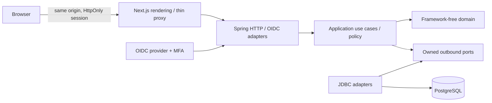
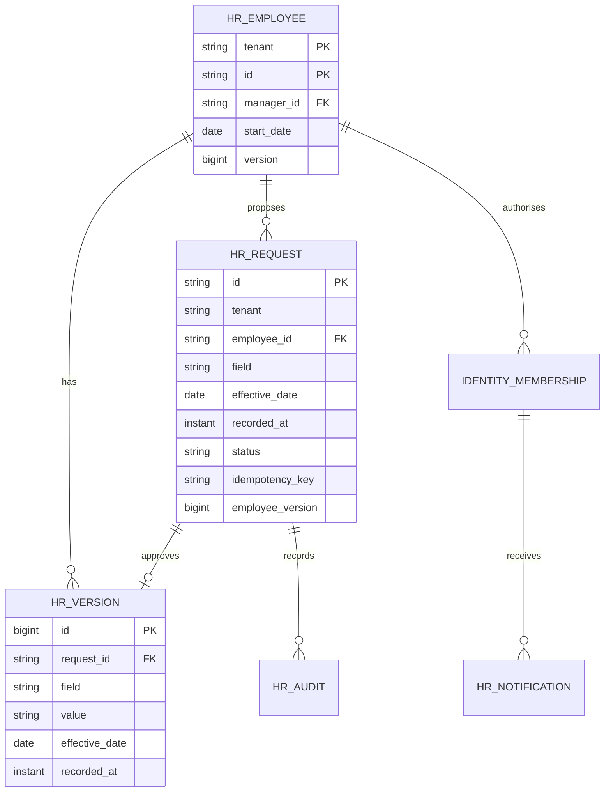
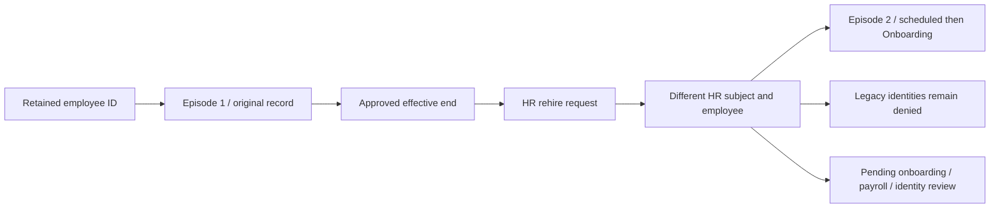

# Architecture and decisions — 2026-10-14

Status: Phase 0 decisions retained; Phase 1 and Phase 2 incremental delivery with executed evidence in verification.md. Source/phase gaps remain tracked; production NOT READY. Independent product, named Atlas. No SAP or Workday integration assumed.

## ADR-001: Java modular monolith
Java 21 + Spring Boot 4.0.8, Spring Security, JDBC and Flyway; PostgreSQL 18.6. Java offers mature transactions, OIDC integration, deterministic domain tests and a broad maintenance ecosystem. Go has small deployable binaries and good concurrency, but requires more integration work for enterprise identity and transaction conventions. One JVM is operationally sufficient; no broker, cache or distributed services without measured need.

Next.js 16.4.0 / React 19.3.0 already installed; strict TypeScript; native accessible controls, CSS tokens, feature-oriented client components, typed fetch with AbortController and no-store. Native forms plus server validation. No client business-policy authority. Node 24.19.0. Pin direct packages and retain npm lock. Maven parent manages transitive versions. Container tags are pinned versions; digest pinning and image scans are release gates.

Official compatibility references: https://nextjs.org/docs/app/getting-started/installation (Node >=20.9), https://docs.spring.io/spring-boot/system-requirements.html (Java 21 supported), https://www.postgresql.org/support/versioning/ (18 supported). Local Next.js bundled installation, layouts and server/client guides read before coding. Exact runtime interoperability requires executed tests, not just documentation.

## ADR-002: Boundaries
Business modules: corehr, time, documents, payroll, talent, finance, procurement, inventory, sales, manufacturing, assets, projects. Shared identity contracts remain small. Within each: domain/model, application/usecase and port/in + port/out, adapter/in/web and out/persistence, configuration. Domain contains only JDK types. Application owns ports, policy and transaction intent. Composition wraps commands in database transactions. Controllers only call use-case contracts; JDBC adapters only map/query/persist. No framework annotations in domain or application. ArchUnit checks dependency directions and includes a deliberately invalid fixture proving enforcement. Spring Modulith considered: useful when multiple published module APIs exist; ArchUnit is the initial gate and explicit cross-module contracts are required in later phases.

## ADR-003: Data and time
Employee PK is tenant + unique employee ID. Employee -> EmploymentVersion (business effective local date, recorded UTC instant); Employee -> ChangeRequest -> Decision; request/decision -> immutable AuditEvent and in-app Notification. Manager ID is tenant-local FK. A request carries employee version and unique actor-scoped idempotency key. Decisions lock the request and employee, reject stale versions, prohibit self-approval, and append effective-dated history in the same transaction. Future versions are read as-of server business date, not applied early. UTC clock is injected. Backdated corrections that collide with later history are blocked in Phase 1; explicit correction workflow follows Phase 2. PostgreSQL read committed plus bounded row locks; version checks protect stale forms. Audit old/new data remains private and scoped.

Phase 1 owns its approval, audit and notification records inside corehr. Other modules must use published contracts later, never query these tables. Reporting projections will have explicit owning module, tenant scope and consistency metadata before implementation.

Money in later phases uses BigDecimal, explicit currency and configured rounding; snapshots and versioned demonstration rules only until country rules are approved. Payroll release requires independent approval and unique payment/posting keys. Real balanced finance posting is required in Phase 4; provider sandbox success is not live readiness.

## ADR-004: Deployment and API
Browser -> TLS ingress -> Next.js -> Spring -> private PostgreSQL; private object storage and scanning adapter in Phase 2. Local compose supplies PostgreSQL; local identity adapter is explicitly development-only. Production uses maintained OIDC provider with MFA policy; no header-based tenant selection. Principal subject resolves through server-owned membership. Production must not enable local credentials.

/api/v1; JSON; bounded lists, explicit page/size, allowlisted sort/filter. Errors carry status, safe detail, correlationId. 401 unauthenticated, 403 denied, 404 unavailable scoped resource, 409 conflict, 400 validation. POST requires CSRF token with cookie sessions. Commands carry idempotencyKey; conflicting reuse rejects. No automated mutation retries. Fetch timeout 10 s, abort superseded reads. Sensitive responses no-store. Mutations reload authoritative data. No credentials in browser storage. Database IDs and tenant context never establish authority by themselves.

## Open decisions
Countries and statutory rules; legal entities; tenancy model; workforce size and growth; IdP and MFA claims; payroll/bank/email/access integrations; hosting budget; data residency; retention owners; supported locales. Reversible local assumptions: one synthetic tenant, 12 employees, English, UTC effective-date boundary, USD display only, no statutory calculations, HR/manager/employee roles. Proposed capacity: 10k employees growing to 100k. These decisions block live release, not synthetic Phase 1 development.

## Initial data model

Runtime verification: Next.js 16.4.0 + React 19.3.0, Java 21 + Spring Boot 4.0.8, PostgreSQL 18.6 and Keycloak 26.8.0 worked in the executed synthetic workflows. Native CSS is used; the starter Tailwind loader was removed after stale-style/build issues. Spring Security owns OIDC code exchange, issuer/audience validation and cookies; the browser only receives the scoped membership view. The OIDC sandbox uses the maintained provider's TOTP capability (official release: https://www.keycloak.org/2026/10/keycloak-2680-released). Live provider policy and backchannel revocation remain release gates.

Phase 1 deliberately returns bounded authorised arrays (1000 employees, 500 requests); filters, sorting and page controls are frontend-only over that bounded set. The proposed server pagination/filter convention is not yet implemented and must precede large-workforce deployment. API contracts are explicitly typed and documented in OpenAPI; automatic generation is a future improvement. Core use cases expose dedicated AuditEntry and Notification DTOs rather than JDBC map types.

### Application-owned read policy
`PeopleService` resolves each validated actor into `PeopleReadScope` (tenant, subject, employee ID, tenant-wide read permission, direct-report read permission). Only the application chooses those permissions; JDBC binds them as query constraints. The adapter cannot call Actor role/policy methods: an ArchUnit gate and a deliberately invalid outbound adapter fixture enforce that boundary. Identity construction rejects missing identity scope and unknown roles. This scope is an internal application contract, never accepted from HTTP input.

### Directory query contract
The directory uses `/api/v1/directory` and application `DirectoryQuery`/`DirectoryPage`, with no framework pagination types in core interfaces. `PeopleReadScope` governs items, totals and facets. PostgreSQL applies current effective values before filtering and stable name/ID ordering. HTTP rejects out-of-range sizes and unsupported direction. Search is literal substring matching with bound parameters. Page/count/facets are separate read-committed reads (refresh reconciles concurrent changes); no snapshot guarantee. Existing capped bootstrap/dashboard/organisation lists remain separate follow-up work.

### Workspace counts and profile access
Workspace bootstrap uses database aggregates via `PeopleSummary` for total, active, on-leave and submitted-request counts. Aggregates use the same application-selected tenant/self/direct-report constraints as directory and requests. The direct employee profile use case reads within the actor tenant and enforces domain record policy; it never depends on membership in a downloaded page. Organisation remains an explicitly labelled first-100 preview. Request counts describe visible submitted requests, not necessarily actionable independent-review tasks.

### Approval inbox query
`RequestQuery` and `RequestPage` are framework-independent application models. `/api/v1/request-inbox` validates status and bounded page/size parameters; JDBC applies the application-provided `PeopleReadScope` to both count and page. Stable ordering uses recorded UTC time descending and ID ascending. Count and rows are read-committed queries, not a snapshot. The UI no longer consumes the legacy 500-row request endpoint.

### ADR: JDBC-backed web sessions
Use Spring Boot 4.0.8-managed `spring-boot-starter-session-jdbc` / Spring Session 4.0.5, verified from resolved artifacts. The framework integration stays in the outer infrastructure layer; domain/application imports remain framework-free. PostgreSQL owns session and attribute tables through additive Flyway migration V4, copied from the resolved vendor PostgreSQL schema; auto-initialization is disabled. Cookie name remains JSESSIONID; idle timeout is 30 minutes. Official references: https://docs.spring.io/spring-boot/reference/web/spring-session.html and https://docs.spring.io/spring-session/reference/configuration/jdbc.html.

Session state is shared across API instances. A two-process test verifies reuse, restart continuity, peer logout/copied-cookie denial and persisted expiry. Default attribute serialization is framework-managed JDK serialization; session-table writes must be limited to trusted application/database operators and storage encrypted by the selected production platform. Attribute compatibility across application/library upgrades requires staged upgrade testing; do not assume arbitrary cross-version session portability. OIDC code flow/MFA/provider logout was separately exercised with JDBC sessions. Backchannel provider revocation and an administrator's revoke-all workflow remain open.

### Executed response contracts
`tests/support/contract.ts` loads response schemas from `docs/openapi.json` using Ajv's JSON Schema 2020-12 implementation and ajv-formats. `tests/contracts.spec.ts` validates actual authenticated API responses and deliberately malformed fixtures. The frontend's TypeScript contracts are still maintained manually; schema-to-type generation and exhaustive request validation remain follow-up work.

### Department reference ownership
Corehr owns Department and its creation audit. OrganisationUseCases is an application contract used by web adapters and PeopleService; the employee-change controller never reads reference tables. Configuration composes separate JDBC stores and bounded transaction wrappers. Department names/codes/parent/cost-centre mappings are immutable for this increment; future changes require explicit effective versions and costing compatibility. Tenant parent FK, unique code/name, audited creation and actor-key idempotency constrain integrity. Legacy names are preserved and DEMO costing codes are labelled. Finance integration will use published contracts instead of querying HR tables.

### Hiring workflow and transaction ownership
HiringUseCases/HiringService is a separate application workflow within corehr. HireDetails owns input invariants; HireRequest owns submitted/decided transitions and independent-employee review; Employee.forHire constructs initial Onboarding state. Application checks reference/access/duplicate policy and supplies the domain snapshot to the JDBC adapter. A bounded transaction locks the hire request and coordinates employee, audit, notification and durable employee-created handoff writes. Each approved hire is associated with one employee and one unique event. Separate requests racing on one normalized work email are protected by the database unique index. No identity account or payroll record is created by this increment. Downstream consumers require published contracts, idempotent delivery/retry/reconciliation and country/entity configuration before completion.

### Manual onboarding transition
Employee owns the Onboarding → Active invariant and start-date guard without framework dependencies. HiringService enforces HR policy, replay consistency and optimistic version intent in the existing bounded transaction. JDBC implements the status update plus immutable completion and pending event; it does not choose transitions. Completion business-effective date is the actual UTC confirmation date, distinct from original employment start and UTC recording instant. Team history redacts reasons in application policy. V10/V11 enforce unique initial completion and composite tenant/hire/employee integrity. This is manual confirmation; background activation and downstream consumers remain planned.

Optional private-field removal reuses ChangeRequest and effective versions. The domain permits explicit empty strings only for address/emergency fields; null/whitespace and required field blanks fail validation. Existing application no-change, access, optimistic version, independent review and transaction boundaries apply. Empty version values supersede earlier values without removing audit history; no migration or new dependency is needed.

### Position reference ownership
Corehr owns Position and creation audit through OrganisationUseCases. The domain validates code/title/department/date shape; application enforces HR creation, tenant department existence/start consistency and idempotent snapshots. JDBC owns parameterised search/count/page and atomic reference/audit writes. V12 enforces tenant/code, actor/key and same-tenant department constraints; immutable triggers prohibit editing/deleting references/audit. PositionPage is framework-independent; title ordering is validated at the core boundary and code breaks ties. Count and page are read-committed statements, not one snapshot. This is a reference catalogue; no employee assignment or inferred reporting line is implemented.

### Effective-dated primary position assignment
Employee exposes one positionCode (empty means Unassigned). It is an employment attribute independent of title, pay and manager. PeopleUseCases reuses the change approval workflow; OrganisationUseCases publishes position/dept validity within corehr. With employee row locked, application validates proposed department/position pairs at the command date and every approved future department/position boundary. The domain owns department/date alignment and employment-start guards. Existing later-same-field and employee-version guards prevent replacing a scheduled future version. Approval atomically writes effective version, immutable FK-backed assignment ledger, decision audit and notification. V14 requires each assignment ledger row to match an approved request and effective version. Read models derive as-of position from hr_version; recovery reconciles both representations.

Effective field reads order by business date, recording instant, then version ID. The ID breaks ties when two sequential approvals share an instant; a fixed-clock PostgreSQL test proves assignment followed by unassignment remains correctly ordered.

### Effective reporting and access
PeopleUseCases owns reporting commands/candidate reads. ReportingHierarchy is framework-free and validates employee/manager start dates plus self/ancestor cycles at each affected approved future manager boundary. Provisional management eligibility is application-owned HR/MANAGER membership; JDBC accepts the policy role set. A tenant-scoped PostgreSQL transaction advisory lock serializes reporting mutations and hire approvals before row locks. Hash collisions can conservatively serialize unrelated tenants; they cannot mix data. Transaction timeout remains 10 seconds. Validation fails visibly above 10,000 employees or 256 future boundaries instead of using a truncated graph.

Effective manager projection is applied consistently to profile, directory, legacy lists, summaries and inbox scopes at the injected UTC business date. Manager changes do not grant a role. Requester visibility for their own non-private submissions remains intentional; team record/history access is removed when the line changes. V15 assignment ledger mirrors approved manager versions with employee/manager/request foreign keys and consistency/immutability triggers. Reporting changes and position changes remain separate commands.

### Employee display-name projection
Name is now a supported effective employee field. Employee/HR may initiate; independent HR decides. Domain validates bounded Unicode strings and rejects control characters/blank values. Directory/profile/legacy employee reads, request display names, manager candidates and Actor workspace labels use the same as-of name rule with effective date/recording instant/version-ID ordering. Membership continues to own subject/tenant/role/employee ID; the workspace name is an employee projection, not an identity-provider profile update. Audit and commands retain stable identifiers and old/new name values.

### Pending-change withdrawal and command replay
Requester-owned withdrawal is a distinct application use case and domain transition, not rejection by an approver. Request row lock arbitrates review versus withdrawal; terminal requests cannot be reopened or withdrawn. V17 records immutable reason/key/actor/correlation and requires a matching requester-owned Withdrawn state. Audit and in-app notice commit in the same transaction; no employment version is created. Private-field owner visibility is checked under current permissions. Non-private owners retain their own request context when team scope changes, consistent with inbox policy.

Submit now requires a nullable boxed version at the transport-independent command boundary; missing/null is invalid, rather than default zero. Input shape is validated before replay; new-command date-range validation occurs after matching replay lookup. Identical past-effective replay can recover an existing request; new backdated commands remain invalid. Input, identity and field permission checks still apply to replay.

### ADR: benefits capability and governed shared errors
Benefits owns BenefitPlan and configuration audit, with framework-free domain/application and explicit web/JDBC/workforce adapters. Core HR publishes WorkforceAccess.self(subject): authenticated subject, server tenant/employee/role and own employment status/start only. Benefits integration adapter maps that contract into its own application context; it never accesses Core HR internal classes or tables. ArchUnit enforces both capability directions and a forbidden-import fixture.

The shared domain package contains only AccessDenied, CommandConflict and InputValidation error primitives. Existing Core HR error types retain compatible subclasses; the outer HTTP error adapter translates shared errors. Identity, money, rules and repositories are not centralised in shared code. Each capability owns its UnitOfWork port and framework transaction composition. Benefits tables/triggers are independently owned; no cross-module foreign keys.

Benefit eligibility is explicitly DEMONSTRATION, based on current self employment snapshot plus plan start/service days. Fixed monthly contribution is configured decimal data, normalized exactly to two places with UNNECESSARY rounding; API transmits decimal strings. One evaluation date governs a catalogue response. Immutable plan rule version is stored (V19), not inferred from deployment alone. Plan listing applies domain eligibility before filter/sort/page, with visible 1000-reference protection. No actual enrolment, dependant calculation or payroll output exists yet.

### ADR: benefits selection snapshots and payroll handoff
Benefits owns selections, dependant snapshots, append-only decision audit and pending deduction handoffs (V20/V21). Core HR publishes an additional minimal `WorkforceAccess.employee` contract: only self or HR, server membership and tenant enforced by Core HR; benefits imports no internal HR classes/tables. Employee ID captured at submission prevents alias self-approval even after a requester identity mapping changes. Current HR employment snapshot is rechecked against the original business date before approval.

The DEMO-FIXED-MONTHLY-v1 policy fixes monthly employee contribution independent of dependant count. No surcharge/proration, statutory eligibility or provider contract is inferred. Up to five named dependants, relationship only; no government IDs or dates of birth. Submission UTC local date is the benefit effective date; future/backdated selection is not exposed. Approved snapshot creates one `PENDING_PAYROLL` row atomically with audit. No payroll consumer, accounting/payment or provider delivery exists; this is an owned pending handoff, not verified payroll integration. Phase 4 must consume via a published contract with idempotency/reconciliation and validate country/entity/company rules.

READ COMMITTED, bounded 10-second transactions: tenant/employee advisory lock serialises submissions; partial unique index prevents multiple pending/approved employee-plan selections; request row locks arbitrate decisions. Deferred database checks reconcile final state, plan snapshot, audit and handoff at commit. Plan/dependant/audit/handoff records cannot be updated/deleted by normal workflow; selection changes only PENDING→APPROVED/REJECTED with version 0→1. Paginated selection reads use bounded adapter queries, including per-request history/dependants; load targets remain unmeasured. Cancellation/amendment and downstream correction semantics remain planned.

### ADR: private employee text documents, local storage and scanning ports
Documents is a separate capability with framework-free `DocumentPolicy`, application use cases and owned persistence/storage/scanner/identity ports. It consumes only Core HR's published self-employment contract; an architecture rule and forbidden-import fixture enforce that boundary. V22 owns metadata/audit and its own immutable-record functions; no other module's tables or trigger functions are used.

Initial workflow supports own UTF-8 .txt uploads of 1–16384 bytes, with a provisional 100-document employee cap; HR reads tenant records, employee/manager reads self only. Filename/type/content validation, availability from CLEAN/INFECTED/UNAVAILABLE verdicts, access policy, hashing and replay checks stay in the core. The ClamAV adapter translates the documented [INSTREAM protocol](https://docs.clamav.net/manual/Usage/ClamdProtocol.html) and does not decide business availability. The pinned local image is configured according to [official Docker guidance](https://docs.clamav.net/manual/Installing/Docker.html); bundled signatures are intentionally a demonstration limitation, not production malware assurance.

Private object keys are SHA-256(tenant)/SHA-256(content), generated server-side; keys and hashes are not public DTO fields. The local adapter is outside web/static directories, enforces canonical paths/no symlinks and POSIX 0700 directories/0600 files. It is enabled only for local/oidc-demo profiles; production needs a private object-store adapter, encryption/access policy and validated scanner freshness. No public object URL or client tenant selector exists. Download authorisation precedes object access, requires AVAILABLE and matching byte count/hash, returns an attachment with no-store/nosniff/sandbox headers, and records authorisation rather than claiming network receipt.

Storage and scan occur outside the 10-second database transaction. Metadata plus immutable upload/scan audits commit together; tenant/employee advisory lock and database uniqueness serialise duplicate commands/quota checks. A crash or database failure can leave an unreferenced private object; no automatic destructive cleanup is exposed while retention policy is unresolved. Partial/corrupt objects fail integrity checks and require operator repair. This is not an atomic database/object-store transaction. Scan outage produces QUARANTINED with blocked retrieval; retries/versioning are next Phase 2 work. Restore verifies database metadata and independently copies/hash-checks referenced objects into a separate private root; production encrypted backup/PITR remains unverified.

### ADR: append-only document scan retries
V23 adds a documents-owned immutable retry ledger. Original upload/initial scan metadata remain unchanged; catalogue/download projections coalesce the latest committed retry status/scanner/attempt. Original audit plus retry records form the authorised history. Retry events retain actor, reason, UTC instant, correlation and scanned content hash; no second write to the initial upload audit is needed. The projection is immediately consistent after the command commit, under READ COMMITTED; list pages are not a global snapshot across concurrent uploads.

Only HR may rescan QUARANTINED content; three retries maximum, with AVAILABLE/REJECTED terminal. Required expected attempt is parsed exactly (fractional values rejected). Scanner work occurs outside database transactions and is repeatable; the final transaction locks the original document, rechecks authoritative identity/version/state/key and appends one result. Concurrent calls may perform duplicate safe external scans, but only one ledger result commits for a version. Identical key replay returns the recorded attempt snapshot even if a later attempt changed current status; upload replay returns the current document projection. Catalogue refresh shows latest availability. A request interrupted before commit can repeat safely; after commit it replays without another scan. There is no background job, automatic retry, durable RUNNING lease, exactly-once external delivery or manual malware bypass.

Database triggers enforce original quarantine, matching hash, sequential attempt ≤3 and previous quarantine; immutable rows/unique keys enforce retention of every result. Download audit validation uses effective availability while original scan audit stays intact. Production scanner freshness and object-storage/retention policies remain separate release gates.

### ADR: immutable employee document versions
V24 adds a Documents-owned append-only root/parent/version ledger. Each replacement creates new immutable metadata, bytes and independent scan/audit records. `DocumentVersionPolicy` enforces append-to-latest and bounded ordinals; the application enforces identity, record access, exact expected version, stable command replay and employee quota. Database foreign keys, unique parent/root ordinal and owner/snapshot/sequential triggers protect integrity. Initial files project as version 1 without rewriting earlier migrations or data.

Storage/scanning precede a bounded transaction. Final identity revalidation, employee advisory lock and root row lock protect quota and concurrent append; one competing command wins. Metadata, scan audits and version link commit atomically. A replay returns the recorded version, even after later appends. UI/search/count show latest uploaded version, including blocked latest; explicit historical downloads still require authorisation and that version's current clean scan/hash/size checks. There is no implicit fallback or legal-validity claim. Limit: 100 total stored files per employee and 100 versions per chain. Templates, retention/legal holds/completeness and production storage remain open.

### ADR: configured templates and document completeness
Documents owns `DocumentTemplatesUseCases`, framework-free configuration/completeness policy and ports. JDBC/web adapters and composition remain outside the core. V25 owns immutable tenant template configuration and document evidence ledgers; existing document metadata/bytes are unchanged. Templates are reusable plain text with explicit required flag and local effective date. Configuration applies to every employee record in the tenant; it is not a statutory policy. Limits: 100 templates, text 4000 characters, existing 100 stored-file limit per employee. Template amendments, targeting, unlink/reclassification and content approval remain planned.

An authenticated self/HR record check uses only Core HR's published workforce contract. Linking requires a current clean version and exact ordinal; root row and employee advisory locks serialize with version changes and competing classifications. Unique tenant/code/employee and tenant/root keys prevent duplicate classifications. Stable command replay returns the recorded link even after later versions. Immutable creation/link snapshots retain actor, reason, UTC recording instant and correlation ID. A database trigger checks the owner/root, latest ordinal and clean availability at insertion. Clean means scan availability, not content validity.

Completeness uses injected UTC date and latest version/scan projection: NOT_YET_EFFECTIVE, OPTIONAL, MISSING, PRESENT or BLOCKED. A rejected/quarantined replacement blocks required completeness without historical fallback. Read checks are bounded live projections, not a transactionally frozen compliance report. The UI permits own checks and HR lookup of a server-authorised employee identifier; identity/tenant are never selected by client request. No new service, cache or message broker is needed.

### ADR: append-only template maintenance and HR corrections
V26 adds Documents-owned template revision and classification-correction ledgers, leaving V25 creation/link rows unchanged. DocumentMaintenanceUseCases separates privileged maintenance orchestration; DocumentTemplatePolicy owns version/date/terminal-retirement transitions. Configuration projections select latest ordinal effective on injected UTC date; future snapshots and all prior text/reason/actor/timestamps remain in revision history. Same-day changes use ordinal order. Dates must be today/future and nondecreasing; a retirement snapshot is terminal, including scheduled retirement. No implicit withdrawal/reactivation or independent approval exists yet.

HR corrections append a new current classification for an existing employee/template, requiring exact current classification and clean latest file ordinals. Current completeness switches to the replacement root; old roots stay reserved and readable under original document permissions. No evidence, private content or initial audit is deleted. Unique correction ordinals, previous-root consistency, owner/latest/clean checks and immutable triggers provide SQL integrity. Initial and correction writers serialize through tenant template lock → employee lock → candidate root lock; original link rows also serialize direct SQL correction sequence checks. Reservation guards prevent a historical root from being reused as initial evidence. Maximum 100 revisions/classification snapshots; global event view returns latest 100, per-template history retains its bounded complete trail. Live projections remain non-frozen reports, not legal compliance or content approval.

### ADR: chain retention directives and independent legal holds
Documents owns DocumentRetentionUseCases/Service, framework-free DocumentRetentionPolicy, persistence port and web/JDBC adapters. V27 appends one per-root governance journal; V28 adds original-subject release protection without changing an applied migration. HR explicitly supplies retain-until date and company policy basis, not a statutory default. Policy dates start today/future and may only extend; date-only comparisons use injected UTC business date, inclusive through retain-until. States: NO_POLICY, RETAIN, REVIEW_DUE, ON_HOLD. Due means review, never permission to delete. Country/category/entity policy validation and production records governance remain unresolved.

Multiple case holds are independent. Active case references are unique within the chain; release requires a different actor subject and employee identity, protecting aliases and identity rebinding. Hold placement/release and policy writes share exact root governance ordinal, bound idempotency key and immutable actor/employee/reason/UTC recording/correlation snapshot. A command locks employee then root in a 10-second transaction; sequence/shape/owner/root/non-shortening/hold transition/independence/append-only SQL guards provide second-line integrity. At most 100 journal events; overflow fails closed with no bypass.

Any file version resolves to its immutable root, so governance includes historical and future versions without copying legal data into employee-visible document audit. Review and mutations are HR-only; the existing workforce contract supplies server identity and tenant. No private-object delete, archive, purge or financial-history deletion port is introduced. Future archive/deletion processing must consult governance through a published contract and reconcile all live/archived/deduplicated references and backups before any destructive action. `deletionAvailable` is always false in the API contract.

### ADR: minimal scoped organisation branches
OrganisationBrowseUseCases/Service owns a separate chart read workflow within Core HR. It resolves the current actor inside a 10-second read-only REPEATABLE READ transaction; branch, count, visible-manager context and effective projections share one UTC as-of date/snapshot. PeopleReadScope.of centralises the existing HR/manager/employee policy, and Actor.canReadEmployee reuses domain record checks. JDBC translates application scopes; it neither resolves roles nor reads another module's tables. No migration, graph database, cache or distributed service is needed.

The chart port returns scoped internal entries; HTTP exposes only ID/name/title/department/position/status and visible-direct-report count. Effective fields use the same approved-version date/recording/ID order as existing people reads. HR roots cover the tenant hierarchy; manager/employee root is self, with manager access limited to current direct reports. Hidden manager identifiers and hidden descendant counts are not returned. Root/branch/global literal search is sorted by lower-case name then ID, with size 1–50 and bounded page. Parent and non-empty search are mutually exclusive. Invalid or inaccessible parents fail without mutation. Results include current onboarding records; this does not implement future scenario planning.

UI is independent of directory page/filter state, shows one branch at a time, keeps up to 50 recent branch locations, and preserves chart state around a profile panel. Profile opening fetches the real profile API, repeats access checks and aborts on navigation/identity context change. Graph-wide rendering, matrix lines, root removal, bulk hierarchy changes and position-capacity policy remain outside this delivered subset. No workload latency/capacity target is inferred from correctness fixtures.

### ADR: resignation acceptance precedes exit execution
Core HR owns Resignation domain transitions, ResignationUseCases/Service, application command/page/audit models, persistence port and HTTP/JDBC adapters. Composition supplies injected UTC Clock, 10-second READ COMMITTED write transactions and read-only REPEATABLE READ list/history transactions. Identity and tenant resolve inside each use case. Self submission applies to active/on-leave employees of every role; no on-behalf or manager-team case access. Independent HR review requires both a different subject and employee identity. This is provisional company workflow, not a country notice-period calculation. Proposed last working date is today through one year; past-date approval is blocked, rejection remains available.

V29 owns tenant-keyed request, immutable audit and immutable pending exit-handoff tables. Additive V30 strengthens audit-only insert reconciliation without rewriting V29. Employee lock → request lock serialises decisions; an exact employee-version snapshot prevents stale approval and an exact request ordinal protects review. Submission/decision keys bind stable inputs; identical replay returns the original request outcome even after date changes. One outstanding submitted/approved case per employee; rejection allows fresh submission. SQL snapshot/transition/independence/unique/foreign-key guards and deferred audit/handoff reconciliation protect integrity. Approval atomically records decision, audit, one PENDING_EXIT_COORDINATION handoff and a private requester notification. No employee status/version, payroll record or identity account changes. Future delivery attempts must use a separate persistent delivery ledger, not edit this immutable handoff.

UI uses feature-local typed contracts, cancellable scoped reads, no sensitive browser storage, preserved errors/linked focus, a bounded paginated workspace and explicit review impact. Identity/tenant/role changes remount private state. Separate resignation workspace contributes to SH-02 but is not a unified cross-module inbox; delegation/withdrawal/amendment are not implemented. Full termination, final-pay rules, exit tasks and dated access revocation remain separately tracked dependencies.

### ADR: manual exit-task coordination within Core HR
ExitTaskUseCases/Service owns assignment/completion orchestration, ExitTask holds state/scheduling/assignee invariants, application models carry explicit commands and scoped pages, and web/JDBC adapters remain at the boundary. Composition injects UTC Clock, bounded READ COMMITTED writes and read-only REPEATABLE READ lists/history. Core HR ports stay framework-free; no module table access or distributed service is introduced. HR case reading does not grant proxy completion. Assignee access never invokes or widens private resignation permissions.

V31 adds tenant-owned task snapshots and immutable status audit. Independent HR coordinator locks an approved resignation before appending the next ordinal, with exact expected count and a 50-task cap. An existing tenant employee with configured identity is required. Creation binds tenant/subject/key to immutable inputs; completion locks one task and checks current assigned employee, exact version and stable decision key. OPEN → COMPLETED is terminal; only assignee attestations are accepted. SQL protects approved-case/employee ownership, sequential ordinal, creation snapshots, assignment identity on completion and deferred matching audit count/content. Original resignation/exit handoff is never rewritten. Notifications are atomic private in-app records routed to existing assignee identities and the coordinator.

Due date is an explicitly configured company scheduling date (today through one year), not notice policy or employment termination. Audit effective date retains that due-date business context; recordedAt/completedAt are actual UTC instants. Server derives overdue for OPEN tasks from injected UTC date; late completion is allowed and records actual completion time. No task automatically removes access, settles payroll, returns assets or completes employment. A future orchestration/delivery ledger must coordinate real downstream actions and reconcile outcomes separately. No reassignment, cancellation, reopening, proxy completion or task dependencies in this subset.

### ADR: append-only exit-task management and current-assignment projection
Additive V32 preserves original V31 assignments, completion rows and audit. A tenant/task management journal appends REASSIGN or CANCEL with exact input aggregate version, sequential ordinal (1–100), old/new assignee/state, actor/employee, reason, UTC instant, key and correlation. Independent HR coordinates; completed/cancelled tasks are terminal. Reassignment requires a different configured tenant identity. Cancellation retains the current assignee and all history; it never frees the original 50-task case quota. Stable management replay returns the original immutable event receipt even after later completion, without notifications being repeated.

Core HR owns the synchronous `hr_exit_task_current` view. It projects latest assignment/cancellation over the original task, with completion taking precedence and aggregate version = management ordinal + original completion version. Only Core HR adapters query the view; database permissions should remain with that module's application role, never direct user access. There is no cross-module SQL, cache, async projection or eventual-consistency promise. Read-only REPEATABLE READ use cases keep current assignment, scoped totals and histories in one snapshot. Non-HR lists/history/completion use the current employee assignment; management history/reasons are HR-only. Already viewed client data cannot be recalled; every subsequent authorised API read is rechecked.

Management locks approved case → base task. Task locking is a separate statement before a fresh projected read: a projection evaluated before waiting for the row lock could otherwise miss a newly committed management event. Completion locks the same base task; SQL independently checks latest assignment and rejects cancelled-task completion, including calls from older code. Original creation replay validates original input then reads the current projection. Completion replay checks the persisted terminal aggregate version. Domain/application contracts stay framework-free; adapters implement persistence/HTTP only, composition owns transactions. Database guards enforce sequential immutable management, coordinator/identity facts and terminal states. Notifications to old/new assignee identities contain no management reasons.

Rollback constraint: an application version that reads original assignment directly can disclose data to a former assignee after management events. Such versions are unsafe rollback targets even though new SQL guards reject their obsolete completion writes. Keep management-aware reads/permissions in any rollback build, or roll forward; database point-in-time/logical recovery is a separate audited action. No destructive migration reversal is provided.

### ADR: immutable effective employment end with request-time local denial
Core HR owns EmploymentEnd domain dates/state, EmploymentEndUseCases/Service, explicit commands/context, ports and thin web/JDBC adapters. V33 adds immutable end/audit snapshots plus two unique immutable PENDING handoffs (FINAL_PAY and EXTERNAL_IDENTITY), and an effective-status SQL read projection. Approved last working date is inclusive; first inactive date is the next local date, enforced from 00:00 UTC. This is a provisional company convention, not statutory notice/final-pay logic. HR reason/key/current employee version are required; a different employee must confirm. Employee base status/identity/history remain retained; version increments at scheduling to invalidate stale pending commands. Profile/directory/summary/chart project Ended at the boundary without waiting for a worker.

Scheduling requires approved resignation, Active/On-leave status, no OPEN own-case tasks or other exit tasks assigned to the employee, and no active/planned reports at the end or approved future reporting boundaries (maximum 256 dates). The tenant workforce/reporting advisory lock serialises lifecycle, reporting, hire decisions and task assignment/management before employee/case locks; SQL task guards also acquire it. A recorded end closes case task coordination and excludes the person from new task assignments or reporting-manager/hire-manager choices, even before the cutoff. Existing approved versions/history remain retained; new post-end-effective employee changes fail. No end amendment/withdrawal, rehire, eager background session purge or final-pay calculation is implemented.

Core HR composition now receives one injected Clock; normal runtime is system UTC, and tests can supply a mutable clock without any runtime clock-control endpoint/property. Published WorkforceAccess.requireActive resolves authoritative membership and effective employment. A security-chain filter calls that contract on every authenticated request; local and OIDC sign-in success handlers also check it. At the cutoff, all identities mapped to the employee are denied, and each persisted local session is invalidated when next used. No session cookie, account row or role is a bypass. Provider sessions/accounts are not disabled; an OIDC session cannot re-enter the application after the cutoff. Existing in-flight requests authorised before the boundary are not forcibly cancelled.

V33 is additive; older application versions that ignore effective status/access enforcement are unsafe rollback readers after an end schedule. All readers and authentication paths must be end-aware before accepting schedules. Database recovery, deployment rollback and external identity/final-pay reconciliation are separate release activities. Pending handoffs retain date/time/correlation but contain no invented money or evidence of delivery. Country/entity timezone, payroll law, remote revocation, durable storage and production rollout remain release decisions.

### ADR — pre-effective employment-end withdrawal (increment X)
Retain V33 schedules/handoffs unchanged. V34 adds immutable submission and independent decision tables, a joined HR history, current schedules excluding approved withdrawals, and current handoffs marked SUPPRESSED. These projections belong to Core HR and are immediately consistent in the same database transaction. They are not cross-module table access or proof of external cancellation. Future handoff consumers must use current state and reconcile cancellation before delivery.

EmploymentEndUseCases owns submission/review orchestration with explicit commands and framework-free EndWithdrawal projections. HTTP invokes the input port; JDBC implements the output port; existing composition-root transactions remain bounded at ten seconds. The tenant workforce lock precedes employee locking, so scheduling, withdrawal approval and task/report coordination serialize. Approval increments the employee version; rejection does not. Both actions record reviewer identity, comment, timestamp and correlation. Request/decision replay keys are scoped independently to tenant/actor and checked against stable inputs. At most 20 attempts; one pending request, one final decision per request, no resubmission after approval. No generic CRUD/update/delete route.

Requester and reviewer must be different HR subjects and different employees; neither may be the departing employee. Approval requires the submitted employee snapshot to remain unchanged and the cutoff not to have started. Pending/rejected requests leave status/access unchanged. Approval removes the original schedule's future local effect; this is not post-cutoff reactivation. Recorded instants are truncated down to microseconds before persistence to avoid driver rounding across the midnight boundary. The original approved resignation remains approved, so rescheduling/new resignation/end-date correction are deliberately unavailable pending a separate workflow. Current views drive directory/authentication, candidate selection and task guards. Old binaries ignoring withdrawal are unsafe rollback targets.

### ADR — one independently reviewed replacement end date (Y)
Core HR adds EndRescheduleUseCases/EndRescheduleService and an outbound store, with plain domain/application records, thin HTTP/JDBC adapters and composition-root transactions (ten seconds; repeatable-read context). V35 appends immutable requests, decisions and two pending handoff records per approved replacement; it atomically replaces derived current views without deleting history. V36 suppresses original handoffs by approved replacement identity, never timestamp/correlation equality. Current schedule/access, task assignment and manager validation use the same projection. Original resignation, schedule and withdrawal remain separate evidence.

One HR requests and another subject AND employee reviews; neither may be the departing employee. Exact employee snapshot and stable input replay keys protect writes. Tenant workforce lock precedes employee lock and fresh current reads. Pending withdrawal and replacement reviews exclude each other. Approval rechecks current cutoff, proposed date (today through one year, provisional company guard), unchanged snapshot, all open case/assigned tasks, and active reports across at most 256 future reporting boundaries. Rejection can close a stale/expired request without changing current access. One approved replacement and twenty total attempts per original case; further corrections/withdrawal of the replacement need a later workflow. An approved withdrawal may be rescheduled after the suppressed original date because there is no current cutoff; an effective current end cannot be moved to reactivate employment. This is not employee re-consent, a legal notice rule, rehire or external compensation.

Current handoffs retain suppressed originals alongside two pending replacement targets. Consumers must select current PENDING targets and deduplicate by the immutable source command identity; there is no consumer/live delivery yet. The replacement API never updates old handoffs or treats suppression as a delivered provider cancellation. Old replacement-unaware binaries are unsafe rollback targets. No new service, broker/cache or dependency is introduced.

Open business decision for Y: the local demonstration permits two independent HR employees to approve a replacement date. Accountable HR/legal owners must confirm the required employee consent, authority, evidence and country/company policy before production. The application does not infer consent from the original resignation or a task attestation. Country, entity, tenancy, scale, provider, integration, hosting and residency decisions recorded earlier remain unresolved; no new external access is assumed.

### ADR — rehire into a separate onboarding episode (increment Z)
Retain the person/employee ID, physical original start/job record, contact and effective-change history. V37 appends immutable rehire requests, independent decisions, episode 2 and three PENDING handoffs (ONBOARDING, PAYROLL, IDENTITY_REVIEW). Episode 1 is derived from the existing original record and its current approved end; its original recording instant is unavailable and is displayed as such, never fabricated. Only one rehire is supported in this increment. Current reads before its start remain Ended; from its start they project Onboarding and the new job, manager and start date. Position assignment resets to unassigned. Subsequent effective changes compose with the new episode by effective date/recorded instant. Prior records and end/final-pay handoffs are retained, not closed or deleted.

RehireUseCases owns policy/orchestration through plain command/result/domain records and its outbound store. Composition provides ten-second writes and repeatable-read contexts; controllers invoke contracts only. HR requester and reviewer must be different subjects AND employees, neither the returning employee. Request/review serialize under tenant workforce lock then employee lock. Exact snapshot version, stable keys, one pending/approved request and twenty-attempt bound protect races/replay. Require a current already-effective end, today–one-year start on/after the prior inactive date, configured department and an active configured manager without a scheduled end. Recheck bounded future graph boundaries and pending employee/lifecycle/open exit work and approved future job changes, so old commitments cannot be silently overwritten. Rejection can close stale/expired requests without an episode.

Status is not sufficient to grant access. An approved rehire creates a legacy-identity hold: every retained mapping/alias remains locally denied, including old HR/manager roles and sessions never used during the ended interval. No role or provider account is restored. Fresh identity provisioning, employment-episode session binding and onboarding completion need explicit follow-on workflows. This prevents old cookies from reviving when the profile becomes Onboarding. Real HTTP tests verify this with retained HR aliases. The RehireContext legacyAccessBlocked flag describes the additional rehire hold; false alone never implies eligibility, because original ended employment is independently denied.

The effective job/start projections belong to Core HR, are synchronous database reads, and are used by profile/directory/chart/reporting and published workforce context. They do not permit cross-module table access. Other modules must consume the published context/events. Old end/rehire consumers must become episode-aware before delivery; a delayed episode-1 identity instruction must never disable a newly provisioned episode-2 account. No consumer or external action exists yet.

Open policy decisions: rehire eligibility, prior-service recognition, employee consent/evidence, country/entity terms and fresh access roles/approvers require accountable owners. Local scheduling bounds and Onboarding status are reversible demonstration policy, not statutory entitlement. Repeated cycles/new-episode end, completion, fresh local/IdP provisioning and payroll inputs stay open; all 45 requirements remain in scope.

### ADR — reviewed rehire completion and fresh employment session (AA)

Keep first-rehire completion in corehr: framework-free RehireActivationUseCases/Service own permission, transition, identity nomination, snapshot and reference rules; HTTP and JDBC are adapters and the composition root supplies bounded transactions and Clock. V38 appends four immutable tables and two current views; no applied checksum changes. Workforce lock precedes employee lock. One pending/approved completion, twenty attempts, exact nonnegative versions and actor-scoped idempotency keys bound work. Rejecting a stale request is permitted; approval revalidates its unchanged snapshot, started episode, nominated membership and organisational references. Requester/reviewer must differ by subject AND employee and neither is the target.

Approval atomically increments employee version, records completion and grants exactly one existing mapped subject EMPLOYEE access, regardless of retained raw membership role. Completion takes effect on the review's UTC local date. The current handoff view marks onboarding COMPLETED and identity LOCAL_ACCESS_GRANTED; payroll remains PENDING and original handoffs remain immutable. Manual HR attestation does not prove joining task completion or external provisioning.

Successful local/OIDC authentication alone stamps the server session with the current workforce epoch. Every authenticated request revalidates membership/status and exact epoch; missing/mismatched stamps invalidate the session. Ordinary requests never adopt a new stamp. This prevents even unused pre-end cookies reviving after activation. No epoch appears in UI/API contracts. All unstamped pre-upgrade sessions must sign in again. The public auth-mode discovery omits credentials so rejected legacy cookies cannot choose the wrong sign-in UI. Profile mutation refreshes profile, directory/counts and notifications.

One completed rehire/grant per employee is an explicit current limitation. Grant revocation/replacement, repeated cycles/new-episode termination, IdP account creation/enablement and payroll/benefit consumers remain future work. Old epoch-unaware readers are unsafe mixed-version or rollback targets: drain them before enabling activation writes. Production rollout/rollback remains unverified.
