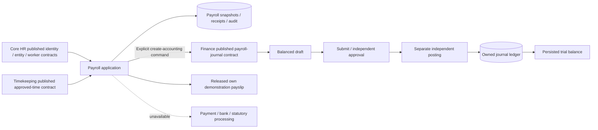

# Payroll and accounting implementation checkpoint

This is a working **demonstration subset**, not completion of the supplied 90-ID baseline or production payroll. [Coverage](payroll-accounting-requirements.md) preserves every ID and 409 decomposed behaviours. Source ERP traceability and timesheet acceptance registers remain independent and unchanged.

## Existing system and implementation boundaries

Next.js 16.4.0 / React 19.3.0 / strict TypeScript, existing native accessible controls and CSS tokens; Java 21 / Spring Boot 4.0.8 / JDBC / Flyway / PostgreSQL 18.6. Existing OIDC/local sessions, CSRF, current Core HR membership, request limits, security headers, no-store responses, correlation logging, bounded transactions and health checks are reused. No new dependency, cache, broker, vendor SDK or external service was introduced.

Before this increment, Payroll and Finance navigation showed roadmap content. Core HR had current/effective employment, legal-entity references/assignments and benefits; timekeeping had approved sheets and an immutable labour-minute ledger. Expenses, procurement matching, invoicing, banks, monetary finance and payroll calculation did not exist. Pending benefit/payroll handoffs are not silently consumed by this increment.

New `finance` and `payroll` modules each contain framework-free domain policy, application use-case contracts/owned ports, web/persistence/integration adapters and outer transaction configuration. Pure `JournalWorkflow` / `PayrollWorkflow` classes own state transitions; application services enforce access and orchestrate ports. Controllers invoke contracts only. Financial JDBC adapters access owned tables only. ArchUnit verifies framework dependency rules and published module boundaries, including a deliberately forbidden payroll-to-finance adapter fixture.



Core HR publishes `FinanceReferenceAccess` without leaking its private tables or domain classes. Timekeeping publishes `ApprovedTimeAccess`; only approved records can be consumed. Finance publishes narrow payroll grant/ledger and journal-preparation contracts. Payroll never directly queries finance or timekeeping tables. Trusted synchronous accounting creation participates in the same database transaction; a rejected finance command rolls back the payroll link and command receipts. Finance does not call back into payroll, so there is no circular transaction dependency. Lock order for this integration is payroll then finance. Independent journal posting follows later.

## Working workflows

1. Declare a synthetic USD legal entity and independently approve a worker's entity assignment through the existing Core HR workflow. Configure its demonstration ledger and cost centres with an explicit setup grant.
2. Worker saves/submits actual time; an independent manager/HR reviewer approves it through timekeeping. Payroll selection reads current authorised approved records, not a mock response.
3. Payroll preparer calculates one worker from one complete approved sheet, entered hourly rate, one voluntary fixed deduction, configured cost centre and accounting date. The result stores source revision/day snapshots, employment episode, entered rate, rule version and decimal breakdown. A timesheet can be consumed once across all runs in its tenant.
4. Nonpositive net pay is a persisted blocking exception. The preparer corrects calculated/returned inputs; submission is blocked until exceptions are clear. A separate payroll reviewer finalizes or returns the result with a reason. The preparer and payee cannot finalize their own result, even when granted the approval action.
5. Finalization freezes the result and releases an explicitly non-statutory text payslip. Employees may retrieve only their own finalized results; downloads are audited. Annual forms and PDF templates are not implemented.
6. A separate command prepares one balanced payroll journal: wage expense debit = gross, voluntary deduction liability credit = deduction, net-pay liability credit = net. The configured cost centre is required on the expense line. This creates no posting or payment. The journal preserves its payroll source identifier and exact totals.
7. Finance preparation, approval and posting require three independent employee identities. Manual journals support draft editing, submission, return/rejection, independent approval and posting. Posted content cannot be edited/deleted. A reversal of an original manual entry creates an opposite draft, independently approved/posted; the original becomes REVERSED only when its counter-entry posts. Direct payroll-journal reversal and reversal-of-reversal are blocked pending their governed correction workflows.
8. Gregorian fiscal-month controls close/reopen through immutable revisions and reasons. Ledger-level locks serialize controls against posting. Reversal can use an open current period while preserving the original period. A closed-period accounting rejection leaves no payroll link or duplicate journal; authorised reopening permits safe retry.
9. Date-filtered trial balance aggregates only persisted POSTED/REVERSED journal lines; original and reversal entries both remain in history. Draft/approved entries are excluded. This is not a complete financial-statement package.

## Exact amounts and state semantics

`BigDecimal` is authoritative. Demo currency: USD, two decimal places. Hourly rate accepts at most four fractional places, positive and at most 1,000,000. Formula: approved whole minutes × entered rate / 60, rounded once HALF_EVEN to cents; net = gross − entered nonnegative cent-precision voluntary deduction. Fixture examples are independently established: 61 minutes × 20.125 /60 → gross20.46, deduction0.46 → net20.00; one hour at1.005 →1.00 and at1.015 →1.02. PostgreSQL independently enforces the same tie rule. Financial HTTP amounts are plain decimal strings, mapped at a shared web adapter limited to finance/payroll controllers. Exact string grouping/padding in the browser preserves cents beyond the JavaScript safe-integer range; no financial amount is converted to binary floating point. Domain models and JDBC snapshots retain BigDecimal.

Rule version: `DEMO-HOURLY-1;USD-2DP-HALF-EVEN;NO-STATUTORY-RULES`. Taxes/contributions are **unavailable**, not a legally applicable zero rate. Entered hourly rate is a run input, not an implemented effective compensation contract. Proration, overtime premiums, YTD, benefits ingestion, arrears and final settlements remain incomplete.

Payroll: CALCULATED → SUBMITTED → FINALIZED or RETURNED; editable calculated/returned inputs may be recalculated. Finalized payroll cannot reopen or be altered here. Accounting link is a separate controlled update. `paymentStatus=NOT_CONFIGURED` is truthful: no bank adapter, payment instruction, acknowledgement or settlement exists. No state in this increment signifies that money moved.

Journal: DRAFT → SUBMITTED → APPROVED → POSTED; submitted journals may RETURN or REJECT, then be corrected/resubmitted. Posted manual journals require a new reversal journal; no silent edits/deletion. Immutable receipts return the original outcome on an identical key retry; reuse for another payload conflicts. Exact nonnegative revision validation detects stale/fractional/overflow values. Database guards independently enforce snapshots, transitions, totals, dimensions, frozen history, reversal linkage and unique source identifiers.

## Configuration and unresolved business decisions

| Decision | Current state | Production dependency |
|---|---|---|
| Legal entities/countries | Existing Core HR references reused; `DEMO-FIN` is a synthetic US/USD declaration | Business-approved entities, jurisdictions, registrations and workforce assignments |
| Payroll populations/pay groups | One approved current-episode timesheet per demo result | Pay groups, eligibility, effective source rules and populations not implemented |
| Pay frequency/calendars/cutoffs/payment date | No company payroll calendar assumed; source week and entered accounting date are distinct | Configured calendars, cutoff and payment scheduling |
| Compensation/components | Entered hourly rate and one voluntary fixed deduction | Approved effective compensation, components, priorities, balances, benefits/absence/expense ownership |
| Statutory rules | None; no filing or tax calculation | Countries and authoritative effective rules, independent expected results and owner approval |
| Standards/chart/ledgers | Fixed illustrative chart6000/2100/2200/1000, one USD ledger per existing entity | Business-approved chart, standards, fiscal calendars and effective mappings |
| Currency and dimensions | USD cents, finite entered cost-centre codes | Approved multi-currency, rates, profit-centre/project/legal-entity allocations |
| Approval authorities | Explicit subject+employee+entity grants; mandatory distinct preparer/reviewer/poster | Approved roles, thresholds, delegation, access provisioning/revocation administration |
| Banking/payment sequence | Unavailable; finalization and posting never imply payment | Provider contracts, sandbox, secrets, acknowledgements, retry/reconciliation and authorised live-release step |
| Retention/privacy | Financial history protected from ordinary edits/deletes | Category retention, legal holds, access audit breadth and archival policy |
| Deployment/scale/residency | Local synthetic configuration only | Hosting, encryption, residency, load/recovery and release gates |

Local V77 grants apply only when `local` loads `db/demo`: Amelia/E001 prepares/configures, Olivia/E005 approves, Marcus/E002 posts, all only for `DEMO-FIN`. HR/manager roles grant no implicit financial authority. Grants are tied to both subject and employee so reassignment does not inherit an old employee's grant. Employee self-service uses server-resolved ownership. Production has no demo grants; audited grant administration remains to be built. These are fixtures, not approved enterprise policy.

## Migrations, local startup and verification

V76 creates nine owned finance/payroll tables with indexes, uniqueness, snapshot/transition/balancing protections and immutable history. V77 is **local-only synthetic grants**. V78 adds source/approval/reversal provenance guards. V79 blocks unsupported reversal-of-reversal and payroll-source reversal drafts at the database boundary. V80 binds financial guard lookup paths to their owning schema so caller context cannot redirect validation. Existing V1–V75 are unchanged. Flyway applies these automatically on startup. No new environment variable, credential or provider endpoint is required. Journal lines are typed, immutable snapshot arrays validated by PostgreSQL triggers; trial balance is a synchronous owner-module projection over those arrays, not cross-module table access.

```sh
# From repository root; PostgreSQL must be available on localhost:5438.
JAVA_HOME=/Library/Java/JavaVirtualMachines/jdk-21.jdk/Contents/Home /opt/homebrew/bin/mvn -f backend/pom.xml -Dmaven.repo.local=/private/tmp/atlas-m2 verify
npm run typecheck
npm run lint -- --max-warnings=0
npm run format:check
npm run build
# Start the API from backend/ using its packaged JAR and the existing local schema flags.
# Start frontend from the root with npm start -- --hostname 127.0.0.1.
npx playwright test tests/payroll-accounting.spec.ts --trace retain-on-failure --max-failures=1
```

Browser test uses serial, fresh synthetic fixtures. Use a **new** schema for a repeated full journey rather than deleting financial history: `--spring.datasource.url=jdbc:postgresql://localhost:5438/atlas?currentSchema=atlas_payfin_browser_<unique>` plus matching `--spring.flyway.default-schema` / `--spring.flyway.schemas`, `--spring.profiles.active=local,acceptance`. Current browser workspace is `atlas_payfin_browser_20261021f`; prior A/B/C/D/E and original `atlas_acceptance` are retained. Switching API schemas is reversible and does not migrate or delete the old data. Existing schemas upgrade through Flyway when selected on startup. The local acceptance profile increases only synthetic test request limits and must not be used with production.

The browser spec creates `DEMO-FIN` through real Core HR APIs, independently approves E003's assignment, saves/submits/approves current-week synthetic time, then exercises the connected UI across separate sessions. It does not transmit a payment or use a vendor system. Run the exact commands and evidence assessment in [verification.md](verification.md).

Read-only financial checks may be run on a **quiescent local synthetic** schema:

```sh
python3 scripts/verify_financial_records.py --schema atlas_payfin_browser_20261021f --output /private/tmp/unique-payfin-integrity.json
```

This checks totals, source linkage, independent approvals, reversal existence and enabled guards, and records hashes/counts for the nine owned tables. It is not a backup/restore or bank-reconciliation exercise. Existing recovery tooling remains tied to its historical acceptance dataset and has not yet been extended/reverified for financial recovery; that is an explicit release gap.

## Operations and remaining integrations

Current same-origin security, structured correlation logs and health endpoints remain in place. No sensitive payroll payload is deliberately written to logs/telemetry. No claim is made for new financial dashboards/alerts, statutory validation, load targets, backup restore, bank sandbox, rollback or migration rehearsal. Read-only health does not establish accounting readiness.

Application rollback and database recovery are different. Additive schema and retained snapshots can remain when rolling back the application binary; an older binary does not understand new workflows. Do not delete journals, change applied migrations or reverse financial history through ad-hoc SQL. Use governed reversal/correction workflows or a validated restore procedure. Full financial restore, migration rehearsal and rollback remain release gates.

For bank/tax/Workday/SAP connections, first implement the remaining owned handoff/adjustment state machines and durable jobs. Obtain verified interface/version documentation, system-of-record ownership, identifiers and effective account/category mappings; provision sandbox credentials externally; validate amounts and signatures, persist acknowledgements, bound retries with stable keys, reconcile rejected/accepted records and corrections, and verify recovery without duplication. Production transmission requires a separate authorised step. No external interface was invented and no successful provider response was fabricated.

Remaining internal work includes every uncompleted criterion in the 90-ID register: bank/tax/profile changes, compensation/pay groups/calendars, source ingestion and declarations, configurable rules/mappings, proration/YTD/statutory/retro/off-cycle/final pay, payment processing, notifications/inquiries/reports, AP/AR/expenses/matching/bank reconciliation, assets/accruals/allocations/intercompany/FX/tax, full close/statements/consolidation, import/monitoring/adjustments and financial recovery. Missing provider credentials explain only the external connection portion, not these internal omissions.

References and which vendor content could actually be inspected are recorded in [payroll-accounting-references.md](payroll-accounting-references.md). Production status: **NOT READY**.

## Requested end-to-end journeys: exact coverage

| Journey | Status in this checkpoint | Evidence / limitation |
|---|---|---|
| 1. Approved time and compensation → result | Partial | Approved persisted time plus entered rate verified. Effective compensation ingestion remains missing. |
| 2. Exceptions block or warn | Partial | Nonpositive-net blocking/correction verified. Configurable warning/variance policy is missing. |
| 3. Approval → finalization and released payslip | Verified demonstration subset | Independent review and own released text document; no statutory/annual document claim. |
| 4. Test payment batch acknowledgement | Not implemented | No batch/provider adapter or fabricated success. |
| 5. Payroll → balanced traceable accounting | Verified demonstration subset | Real persisted source journal, independent approval/post and control totals. Effective full-component mapping is missing. |
| 6. Historical payroll correction → auditable adjustment | Not implemented | Manual journal reversal is not a substitute for retro payroll/payment correction. |
| 7. Supplier invoice → matching/post/test payment | Not implemented | AP/procurement/matching/payment capabilities remain internal implementation work. |
| 8. Customer invoice → receipt/allocation | Not implemented | AR/billing/receipts and allocations remain internal implementation work. |
| 9. Bank transactions reconcile to payments/receipts | Not implemented | No bank adapter/statement/reconciliation capability. |
| 10. Closed period blocks unauthorised posting | Verified monthly-control subset | Actual close/reopen, permission, concurrent transaction and database controls; full close checklist is missing. |
| 11. Statements reconcile to ledger | Partial | Actual trial balance verified; balance sheet/income/cash flow/comparatives/consolidation missing. |
| 12. Restricted payroll/finance access denied | Verified implemented-field subset | Four local roles, altered IDs/cross-tenant denials, own finalized records and explicit grants; bank/tax fields and production review missing. |

Automated checks include real PostgreSQL/domain/architecture tests, actual browser workflows and scoped finance-mobile axe. Manual inspection was limited to rendered finance and payslip mobile screenshots. No manual assistive-technology review, bank/vendor sandbox, statutory-rule validation, new security scan, load/RUM or financial restore was performed. Current worker queries also preserve the existing Core HR field scope: the supplied payroll preparer is HR; a fully independent payroll-admin projection beyond Core HR scope remains implementation work.

Published integration adapters now translate contracts only: Core HR `FinancialReferenceService` owns reference queries, Timekeeping `approvedSource` owns source eligibility, and Finance `payrollLedger` owns payroll access policy. Configuration constructs adapters/use cases and transaction boundaries; it performs no repository queries or approval-policy branching.
